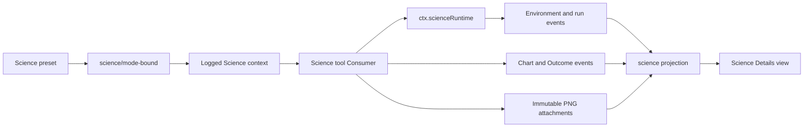

# Agent Note: DSH Science Mode core MVP

Status: proposed

English | [中文](2026-08-12-science-mode-core-mvp.zh.md)

## Problem

DSH can already persist Session events, project durable state, select per-session presets, confine processes, and store immutable image attachments. It does not own a Science-specific domain that answers which environment and prompt produced a run, which run produced a chart version, or which evidence supports a published research Outcome. Building only a Python or R tool would leave those facts in tool prose and make refresh, resume, fork, and audit disagree.

DSH already owns provider and model selection. Science Mode is a native DSH composition over that shared capability; it does not add a provider, custom API adapter, gateway, or CSSwitch dependency. Its durable facts follow the Session log and the [Session projection design](../architecture/2026-07-27-session-projection-and-command-log.md).

The first release must also avoid implying parity with Claude Science. Persistent kernels, environment management, generic artifacts, scientific review, remote compute, and release acceptance each need contracts that this MVP does not provide.

## Proposal

Add Science Mode as four cooperating layers: a Science preset and model-facing tools, a Runtime that binds existing Conda prefixes, a Science Session domain, and a client view in the existing Details column. The Session log is the only durable authority. Runtime handles and mutable scratch files remain process or filesystem state and never become a second Session database.

The [Science Mode execution chain](../../../../docs/science-mode.md) is the current-source map of the cross-subsystem extension points. This record owns the complete MVP responsibility graph and staged delivery decisions.

Development advances one phase at a time. Every phase receives a separate commit, focused verification, fresh independent review, and a stop before the next phase. Dated upstream and downstream identities belong in the [desktop distribution and migration decision](../architecture/2026-08-15-dsh-science-desktop-distribution-reconnaissance.md), not in this product definition.

## v0.1 product boundary

v0.1 is the smallest publishable Science loop, delivered through both Web and Desktop carriers. It includes the existing DSH provider/model experience unchanged; a Science preset; exact-path Python and R execution against an explicitly selected existing environment; immutable versioned PNG charts; a provenance sidebar in the existing Details column; and cold reconstruction from the durable Session projection.

The provenance sidebar lists every chart version and resolves its immutable attachment, source run, environment revision and fingerprint, request context, model/tool action, creation time, and owning Session attribution. User attribution comes only from existing Session actor or identity facts and renders as unavailable when those facts are absent. The chart event stores references rather than copying prompt text, credentials, binary data, or Host paths.

One Science settings card configures an optional Conda prefix, explicit Python executable, explicit `Rscript` executable, and public defaults for Conda channels, a Python package index, and a CRAN mirror. Runtime validates and executes only the selected interpreter paths. Source settings do not authorize downloads or prefix mutation: v0.1 does not bundle Conda, install packages, create or update environments, repair environments, or delete them. A later environment or package manager must consume those settings through its own capability and approval policy.

v0.1 does not include persistent kernels, notebooks, generic artifact types, scientific certification, remote compute, managed environment supply, a plugin marketplace, or a separate Desktop implementation of Science behavior. [The distribution decision](../architecture/2026-08-15-dsh-science-desktop-distribution-reconnaissance.md) owns the Web/Desktop × Standard/Science composition and release boundaries.

## Product decisions

| Subject | MVP decision | Consequence |
|---|---|---|
| Outcome | A model-published current research result plus backward evidence references; it is not a Goal or independent review | Publishing never starts or continues execution |
| Charts | Immutable PNG versions only | SVG, HTML, PDF, tables, notebooks, visual diff, restore, and deletion are deferred |
| Environments | Bind allowlisted existing Conda prefixes and exact Python/R paths configured in the Science settings card | The MVP never creates, clones, upgrades, installs into, repairs, or deletes an environment |
| Python and R | Each language may use a different prefix or the same prefix | Availability and drift are reported independently |
| Execution | One fresh process per call | Variables do not persist; explicit files under `state/` carry cross-call state |
| Package sources | Store public Conda channel, Python index, and CRAN mirror defaults without granting install authority | A later package or environment manager owns downloads, credentials, mutation, and rollback |
| Provider/model | Reuse the existing DSH provider and model capabilities unchanged | Science adds no provider, custom API, gateway, or CSSwitch integration |
| UI | Outcome, Charts, Environment, and Conversation appear as a provenance sidebar in the existing right Details column | The left navigation and generic tool details retain their owners |

## Package ownership

| Package | Responsibility in the complete MVP |
|---|---|
| `@deepseek-ai/dsh-science-session` | The only durable Science record, event, and projection types; one strict event-stream fold; Session applicability policy; derived projection; and invariant companion |
| `@deepseek-ai/dsh-science-runtime` | `ctx.scienceRuntime` plus the sole local Conda implementation: observation, exact-Session leases, scratch, direct-argv orchestration, and result classification. Exported types stay free of Host scratch paths. A second provider, or a production Consumer that would otherwise import local-only types, is the split trigger; see the [Phase 2 architecture note](../../implemented/architecture/2026-08-13-science-runtime-and-local-conda-provider.md) |
| `@deepseek-ai/dsh-tool-science` | Model-visible Science tools that call the domain and runtime services without spawning directly |
| `@deepseek-ai/dsh-client-ui-science` | Read-only projection consumption and the four Science Details tabs |
| Built-in Science preset | Per-session prompt and tool composition; Host-plane runtime and projection services remain outside the isolated preset |

## Science Session domain

### Applicability and mode

The Host registers one `science` projection unit. Its value is `null` until the first valid `science/mode-bound` event, including for Standard sessions; a missing projection key means the Science package is not composed. `science/mode-bound` is legal only when `session.header.agentPreset === 'science'`, occurs once, precedes the first step, request-header, or tool-call fact, and records the fixed mode ID, preset, and a human-maintained mode revision. Every run, chart, or Outcome `requestHeaderSeq` names the latest post-mode header and links its logged prompt plus safe provider/model identity; each record also names one unique, still-pending model tool call after that header. A tool call authorizes exactly one Science fact and cannot be reused after consumption or settlement. A result for that call or the end of its owning step settles it.

### Environment

An environment record has a positive consecutive revision, profile identity, configured and validated times, and independent optional Python and R interpreter bindings. Every binding records the configured prefix and one of `available`, `unavailable`, `invalid`, or `drifted`. An `available` binding also requires its canonical prefix, canonical executable, executable stat identity, language version, `conda-meta/history` digest, and `bindingFingerprint-v1`. A failed binding requires a reason and records only identity facts actually observed before failure, never fabricated sentinel values. Absolute paths accept POSIX, Windows drive, and Windows UNC syntax. The fingerprint is not a package lock. A first run requires the latest environment to be `applied`; after the first run, no new `applied` revision may replace it. Later validation may append an `invalid` or `drifted` revision and block new authoritative runs.

### Runs and recovery

`ScienceRunId`, `ScienceEnvironmentProfileId`, `ScienceChartId`, and `ScienceScratchKey` are package-owned branded strings. Numeric environment, chart, and Outcome revisions are positive consecutive counters rather than opaque IDs. Existing `SessionId`, `CallId`, and `AttachmentId` types retain their current owners.

A run start records language, tool call, request-header seq, environment revision and fingerprint, start time, code digest, scratch identity, and a relative `runs/<run-id>/` reference. Python and R starts require pending `run_python` and `run_r` calls respectively. The referenced tool call already identifies its turn and step, so the Science record does not copy them. A run finish carries the complete terminal run value. The strict fold rejects any finish whose immutable start fields differ, whose time precedes the start, or whose status is not `success`, `failed`, `timed-out`, or `cancelled`.

Only `session/end-seed` derives `interrupted`: at each marker the projection replaces every still-running run before that marker with an interrupted view. It does not append another execution event. A normal aborted turn, caller cancellation, or service disposal must settle the owned process tree and append `science/run-finished` with `cancelled` in the runtime phase.

### Chart versions

A chart record contains a stable chart ID, normalized logical name, positive consecutive version, immutable `ImageAttachmentRef`, title and optional caption, successful source run, pending `save_chart` call, request-header seq, environment revision and fingerprint, and creation time. The event envelope supplies the record's sequence. Phase 1 accepts only `image/png` and only a successful run already present in the same folded log. Version creation times never move backwards. A future diagnostic override for failed runs needs a new decision; the MVP does not infer one.

The client resolves provenance through the owning Session: `requestHeaderSeq` supplies logged request context and safe provider/model identity; the tool call supplies the publishing model action; the source run and environment revision supply execution identity; existing Session actor or identity facts supply user attribution when available. Missing attribution stays explicit and never becomes a fabricated event field.

### Outcome

An Outcome publication contains a positive consecutive revision, title, bounded Markdown summary, at least one backward successful-run, chart-version, or message-seq reference, publication time, the unique pending `publish_outcome` tool call, request-header seq, and the exact sorted set of applied environment revisions used by its run or chart evidence. That set is empty for message-only evidence. The call anchors the model action; the request-header reference supplies its logged prompt and safe provider/model identity without copying them. Publication implies `published`; a newer revision makes the older event historically superseded without rewriting it. The projection exposes only the latest Outcome.

Evidence references deliberately omit a Session ID. The strict fold and invariant receive the exact owning Session stream and resolve IDs only in that stream. A foreign reference therefore cannot resolve and is rejected before append. This keeps forked seed evidence locally referential without creating runtime pointers back to the parent Session.

Outcome and Goal are independent domains. Outcome operations never read or mutate `ctx.goals`, Goal changes never publish or supersede an Outcome, and neither durable event payload references the other domain.

## Events, replay, and projection

| Event | Complete payload meaning | Commit point |
|---|---|---|
| `science/mode-bound` | One immutable Science mode snapshot | Before the first Science step or run; no request fact is copied |
| `science/environment-bound` | One complete consecutive environment revision | After validation has produced a stable observation |
| `science/run-started` | One complete running-run snapshot | Before the runtime phase attempts spawn |
| `science/run-finished` | One complete terminal-run snapshot matching its start | After the owned process tree is fully settled |
| `science/chart-saved` | One immutable chart version and provenance snapshot | After attachment bytes are durable |
| `science/outcome-published` | One complete consecutive Outcome publication | After every backward evidence reference validates |

All six events are log-only, required-on-read, lossless JSON, and whole values rather than patches. Their strict decoders reject unknown fields, unsupported versions, malformed branded strings, non-finite or unsafe numbers, oversized fields, and invalid discriminants. The fold rejects discontinuous event sequences and domain transitions. Science event times may equal but never precede the previous Science event time. A payload timestamp cannot precede any request, tool-call, durable source-run, chart, or message fact it claims as authorization or evidence, and it cannot follow the owning event envelope time. The Session envelope remains authoritative for event seq and time; domain payloads keep only timestamps or seq values that refer to another fact.

The pure synchronous strict fold is the only authority for Science event-stream transitions and provenance. A separate pure applicability policy owns facts outside that stream: the Session-header preset boundary and mode binding before Science-preset host activity. The invariant composes that policy with the fold on `internal/dispatch`, so a violation rejects before `session/event` commits. `replayScience(events)` assumes its owning Session has already admitted the stream. The fail-soft live projection advances an encoded copy of the same accumulator; it does not maintain a second reducer or duplicate provenance rules. Every committed event advances the private observed watermark, while unrelated or malformed events leave the fold and witness unchanged and do not publish a public-value change. Tests require strict replay and incremental projection to produce the same Science value for every admitted live and cold log.

The `science` projection registration uses `stateVersion: 2`. Its private plain-JSON state is `{ observedSeq, fold, witness }`: `observedSeq` is `-1` for an empty log and otherwise names the latest committed Session event passed to the unit; `fold` is the encoded strict accumulator; and `witness` is a sparse, redacted replay stream containing event sequence, time and type, complete Science payloads, and only the call identity, tool name, step coordinates, or evidence identity needed from supporting Core events. Request-header bodies, tool arguments, and message content are omitted. Supporting facts may advance the private state without changing the public value; the registration's `viewChanged` decision suppresses a duplicate change notification in that case.

The generic projection registry admits an untrusted cache row only through the unit's `checkpointStateSchema`. The Science checkpoint validator requires a safe `observedSeq` at or after the last witness event, strictly replays the witness, and requires it to reproduce the encoded fold exactly before the row can be restored. The unit's pure `checkpointStateSeq` extractor also requires that embedded watermark to equal the row's outer `seq`, so a valid older Science value cannot be paired with a newer cache watermark. Schema admission runs only for persisted checkpoints; the extractor also verifies emitted rows, so the same embedded/outer-seq relation holds on both sides of persistence. The public projection schema validates its JSON fields and derived metrics; it does not reimplement historical provenance transitions. The public value contains mode, current environment, complete run summaries, chart-version metadata, latest Outcome, conversation metrics derived only from those facts, and `lastScienceEventSeq`. Binary attachment data, code, stdout, stderr, logs, and Host absolute attachment paths never enter it. The package root exposes consumer-facing identifiers, event types, strict decoders, and replay; mutable accumulator, witness, checkpoint, and transition helpers remain internal. Changing the private state fields or fold semantics increments the registration version rather than putting a version field inside the public value.

## Phase 1 append boundary

Phase 1 introduces no public mutation service. Its tests append typed, complete event payloads through the existing `Session.append()` boundary; the invariant companion strictly folds each candidate before commit, so a rejected event appends nothing. Runtime and tool consumers define their caller-facing mutation operations only when those consumers exist in later phases.

The package does not probe an interpreter, create directories, spawn a process, read attachment bytes, expose tool schemas, inspect Goal state, or render UI. Those actions belong to later providers and consumers. Phase 1 tests may pass already-validated domain snapshots, but they may not simulate runtime success as live evidence.

## Scratch, execution, and process ownership

The local provider uses `<DSH_HOME>/science/v1/owners/<session-key>.json` for a provider-owned identity record and `<DSH_HOME>/science/v1/sessions/<session-key>/` for the writable Session root. The key is `lowerhex(SHA-256(UTF-8("dsh-science-session-v1\0" + exactSessionId)))`. Resume reuses the same key and directories; fork receives a new Session ID, new key, empty `home/`, `state/`, and `runs/`, while inherited event seed and immutable attachments remain replayable evidence.

Each run owns `runs/<run-id>/code.py` or `code.R`, `tmp/`, and `artifacts/`. Its cwd is the run directory, `HOME` is the Session `home/`, `TMPDIR` is the run `tmp/`, and explicit `SCIENCE_STATE_DIR` and `SCIENCE_ARTIFACT_DIR` point to their owned directories. Code is UTF-8 mode `0600`, flushed before spawn, executed by explicit argv with stdin `/dev/null`, and hashed from the exact file bytes. No shell string chooses the executable or code path.

One Session permits one active Python-or-R run. A second request returns `RUNTIME_BUSY` before events or directories and never queues silently. Every acquired lease is released in `finally`. Cancellation and disposal act only through exact owned subprocess handles and await quiescence; the subprocess provider retains process-tree and process-group ownership. Neither process cleanup nor Session disposal deletes a Conda prefix or Science scratch.

The provider starts with an empty environment plus an explicit allowlist. It never inherits provider credentials, `SSH_AUTH_SOCK`, user package paths, or ambient `DSH_*`. Default timeout is 120 seconds with a user-configurable maximum of 600 seconds; stdout and stderr each cap at 64,000 bytes; TERM-to-KILL grace is 3 seconds. The model cannot choose interpreter paths, code paths, or timeouts.

## Prompt compaction prerequisite

Science environment context must be model-visible and reconstructable in the same request that uses it. Before Science tools ship, Core must ensure that pressure compaction, overflow retry, clear, unchanged-context reuse, and cold resume all re-emit a runtime-context snapshot in the same request when a surface replacement removed the retained copy. Science does not add another context database or delivery path.

## Threat model

Science MVP is trusted local code execution with file-write confinement, not a confidentiality sandbox. A clean environment prevents ambient environment-variable credentials from being injected, and existing Conda prefixes remain read-only, but the current sandbox does not prevent code from reading other files or using the network. User-visible limitations must state this in the preset, Environment view, and Science documentation.

The hard guarantees are narrower: no automatic package installation or environment deletion; no credential, chart binary, base64, browser object URL, or Host absolute attachment path in Session events; no chart path outside the current run's `artifacts/`; no model-selected executable or timeout; and no source, fixture, or static test result described as live execution.

## Delivery stages

| Phase | Scope | Exit condition |
|---|---|---|
| 0 | Freeze this decision and establish isolated local source | Formal Agent Note committed; no product code |
| 1 | Science Session events, types, strict fold, projection, invariants, and replay tests | Malformed or discontinuous streams fail loudly; live and cold results match; no public mutation service, UI, model, process, Conda, Python, or R work |
| 2 | [Runtime Service Definition and local Conda provider](../../implemented/architecture/2026-08-13-science-runtime-and-local-conda-provider.md) | Fake-prefix CI coverage plus separately reported real-machine acceptance; owned trees settle; environment prefixes remain unchanged |
| 3 | [Core compaction prerequisite, Science preset, prompt, state query, and Python/R tools](2026-08-13-science-preset-environment-context-and-run-tools.md) | Science prompt and tools are preset-scoped and every used environment context is durable and model-visible |
| 4 | PNG save and Outcome publication consumers | Immutable versions and backward evidence validation replay identically |
| 5 | Science settings card, generic Details extension, and Science client UI | Exact interpreter paths and public source defaults validate; four accessible tabs render only projection truth; Standard sessions have no Science entry |
| 6 | Shared Web/Desktop composition, built-package checks, and local MVP source closure | Standard and Science run through both carriers without duplicated product logic; all named source checks pass and fresh review has no HIGH or BLOCK finding; installer, signing, and publishing remain separate evidence |

Phase 1 changes the Science domain package and only the generic projection/persistence seams needed to serve that domain safely: canonical private-checkpoint admission and state-to-row watermarks, detached JSON values, explicit definition ownership, private/public change separation, exact-lifecycle durable drains, per-session cache serialization, and source-qualified log-revision identity. Repository metadata and architecture documentation change with those contracts. It does not pre-create Runtime, Tool, preset, attachment consumer, or Client packages, and it performs no UI, Conda, Python, R, or process-runtime work.

## Alternatives considered

**Reuse Goal for Outcome.** Rejected because Goal carries continuation authority and mutable lifecycle phases, while an Outcome is an append-only result publication with evidence. Combining them would let a result accidentally drive execution and would make Goal completion rewrite research history.

**Store Science truth in tool results or a UI database.** Rejected because cold resume and fork would need a second reconciliation protocol, and the UI could disagree with the authoritative Session log. Tool call arguments and results retain code and output; Science events retain compact provenance and state.

**Add provider or custom-API work to Science.** Rejected because DSH already owns provider and model selection. Science consumes that shared capability and does not copy CSSwitch proxy behavior or create a second provider stack.

**Start with persistent Python and R kernels.** Rejected because kernel ownership, crash recovery, hidden mutable variables, package drift, and process disposal would dominate the MVP before the durable product loop is tested. Fresh processes plus explicit `state/` make cross-call state visible.

**Manage Conda environments in the MVP.** Rejected because creation, installation, upgrade, locking, approval, and cleanup form a separate capability with larger security and reproducibility obligations. Binding existing prefixes is sufficient to test the product loop.

**Treat the current sandbox as secret isolation.** Rejected because its policy controls file writes, not reads or networking. A container, microVM, or remote runtime is the correct future option when confidentiality is required.

## Acceptance criteria

The complete MVP is accepted only when a Science preset can be created, resumed, and forked; the settings card validates exact Python/R paths and public source defaults without mutating an environment; environment identity and drift are explicit; Python and R execution is bounded and owned; chart and Outcome provenance, request context, and available user attribution are durable or resolvable from the same Session; the four Details tabs rebuild from cold projection; Standard behavior is unchanged; both Web and Desktop use the shared composition; the threat model is visible; named source, composition, built-package, GUI, and replay checks pass; and a fresh independent review has no HIGH or BLOCK finding.

CI fake-prefix evidence and real-machine Python/R acceptance remain separate. A missing real-machine run is reported as `NOT-RUN`, never inferred from unit tests. Source closure does not prove an installed application, signing, notarization, release readiness, or availability in arbitrary user environments.

## Risks

The principal risks are accidental overlap with the existing `ui-journey` work, projection growth in long Sessions, prompt context lost during compaction, environment drift not captured by `bindingFingerprint-v1`, process-tree leaks, shell or ambient-environment provenance bypasses, and users reading model-published Outcomes as scientific certification. Incremental projection avoids replaying the complete prior witness for every live event, but immutable array copying and witness growth still scale with retained history; no constant-time claim is made, and paging or compaction waits for measurement. Isolation by local repository, metadata-only projection, the Core compaction prerequisite, explicit fingerprint limitations, owned-tree quiescence, clean-env execution, and fixed UI wording mitigate these risks without expanding Phase 1.

The pre-release event policy makes every Science event required-on-read. Older builds will refuse a Session containing these events. That refusal is intentional until a separately designed compatibility or migration promise exists.
