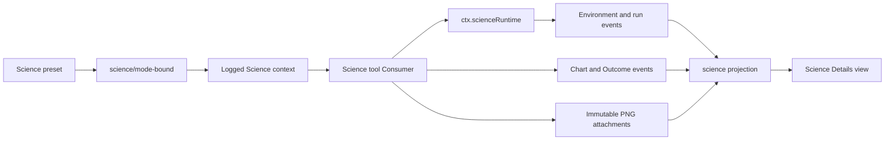

# Agent Note: DSH Science Mode 核心 MVP

Status: proposed

[English](2026-08-12-science-mode-core-mvp.md) | 中文

## 问题

DSH 已经能够持久化会话事件、投影持久状态、选择逐会话 preset、约束进程，以及存储不可变图片附件。但它还没有 Science 专用领域，因而无法回答哪个环境和提示词产生了某次运行、哪个运行产生了某个图表版本，或哪些证据支撑已发布的研究 Outcome。若只构建 Python 或 R 工具，这些事实会留在工具自然语言中，刷新、恢复、fork 和审计将得到不一致结果。

CSSwitch 与私有 `dsh-external` 组织下的仓库不是这些语义的 owner。它们可以为进程所有权提供实现证据，但 DSH Science Mode 是 DSH 原生功能。其持久事实必须沿用会话日志与[会话投影设计](../architecture/2026-07-27-session-projection-and-command-log.md)。

首个版本还必须避免暗示已经达到 Claude Science 对等能力。持久 kernel、环境管理、通用产物、科学审查、远程计算与发布验收都需要本 MVP 尚未提供的约定。

## 提案

把 Science Mode 增加为四个协作层：Science preset 与模型可见工具、绑定已有 Conda 前缀的 Runtime、Science Session 领域，以及现有 Details 栏中的客户端视图。会话日志是唯一持久权威。运行时 handle 与可变 scratch 文件继续属于进程或文件系统状态，绝不成为第二套会话数据库。

[Science Mode 执行链路](../../../../docs/science-mode.md)是跨子系统扩展点的当前源码映射。本记录负责完整 MVP 责任图与分阶段交付决策。

开发一次只推进一个阶段。每个阶段都有独立本地提交、聚焦验证、全新独立审查，并在下一阶段前停止。Science 工作从确切的 2026-08-13 DSH 快照 `7b9644f2b664e46c9518506035aa6c8d5af4d8e8` 播种到一个未配置 remote 的独立本地仓库。它不修改现有 DSH worktree、不创建公开仓库、不触碰 `dsh-external`，也不上传变更。

## 产品决策

| 主题 | MVP 决策 | 后果 |
|---|---|---|
| Outcome | 模型发布的当前研究结果加向后证据引用；它不是 Goal，也不是独立审查 | 发布绝不启动或继续执行 |
| 图表 | 仅支持不可变 PNG 版本 | SVG、HTML、PDF、表格、notebook、视觉 diff、restore 与删除均延后 |
| 环境 | 只绑定 allowlist 中已有的 Conda prefix | MVP 绝不创建、克隆、升级、安装到或删除环境 |
| Python 与 R | 两种语言可以使用不同 prefix，也可以使用同一个 | 可用性与 drift 分开报告 |
| 执行 | 每次调用使用一个全新进程 | 变量不持久；跨调用状态由 `state/` 下的显式文件承载 |
| UI | Outcome、Charts、Environment 与 Conversation 位于现有右侧 Details 栏 | 左侧导航与通用工具详情保留各自 owner |
| 开发隔离 | 从确切 DSH commit 播种、无 remote 的独立干净本地仓库 | 现有 DSH `ui-journey` 变更与所有 external 仓库保持不动 |

## 包所有权

| 包 | 完整 MVP 中的责任 |
|---|---|
| `@deepseek-ai/dsh-science-session` | 唯一的 durable Science record、event 与 projection 类型；唯一严格事件流 fold；Session applicability policy；派生 projection 与 invariant companion |
| `@deepseek-ai/dsh-science-runtime` | `ctx.scienceRuntime` 加上唯一的本地 Conda 实现：观测、精确 Session lease、scratch、direct-argv 编排与结果分类。导出类型不含宿主 scratch 路径。第二个提供方，或否则必须导入仅属于本地实现之类型的生产消费方，才是拆分触发条件；见 [Phase 2 架构记录](../../implemented/architecture/2026-08-13-science-runtime-and-local-conda-provider.md) |
| `@deepseek-ai/dsh-tool-science` | 调用领域与运行时服务而不直接 spawn 的模型可见 Science 工具 |
| `@deepseek-ai/dsh-client-ui-science` | 只读 projection 消费与四个 Science Details 页签 |
| 内置 Science preset | 逐会话提示词与工具组合；Host plane 的运行时与 projection 服务位于隔离 preset 之外 |

## Science Session 领域

### 适用性与 mode

Host 注册一个 `science` projection 单元。在第一条有效 `science/mode-bound` 事件前，其值为 `null`，Standard 会话也如此；缺少 projection key 表示没有组合 Science 包。只有 `session.header.agentPreset === 'science'` 时才能写入 `science/mode-bound`，且只能出现一次；它必须早于第一条 step、request-header 或 tool-call fact，并记录固定 mode ID、preset 与人工维护的 mode revision。每个 run、chart 或 Outcome 的 `requestHeaderSeq` 都指向模式绑定后的最新 header，关联其 logged prompt 与安全的提供方／模型 identity；每项记录还必须指向该 header 之后一项唯一且尚未结算的模型 tool call。一个 tool call 只授权一项 Science fact，消费或结算后不得复用。该 call 的 result 或其所属 step 的结束都会将它结算。

### 环境

环境 record 包含正数且连续的 revision、profile identity、configured/validated 时间，以及独立可选的 Python 与 R interpreter binding。每个 binding 都记录 configured prefix，以及 `available`、`unavailable`、`invalid` 或 `drifted` 之一。`available` binding 还必须记录 canonical prefix、canonical executable、executable stat identity、语言版本、`conda-meta/history` digest 与 `bindingFingerprint-v1`。失败 binding 必须携带 reason，只记录失败前实际观测到的 identity fact，绝不伪造 sentinel value。absolute path 接受 POSIX、Windows drive 与 Windows UNC 语法。该 fingerprint 不是 package lock。第一次 run 要求最新环境为 `applied`；第一次 run 后，不得以新的 `applied` revision 替换它。后续验证可以追加 `invalid` 或 `drifted` revision，并阻止新的权威 run。

### Run 与恢复

`ScienceRunId`、`ScienceEnvironmentProfileId`、`ScienceChartId` 与 `ScienceScratchKey` 是该包拥有的 branded string。数值型 environment、chart 与 Outcome revision 是正数连续计数器，不是 opaque ID。已有的 `SessionId`、`CallId` 与 `AttachmentId` 类型继续由当前包持有。

run start 记录语言、tool call、request-header seq、environment revision 与 fingerprint、开始时间、代码 digest、scratch identity，以及相对 `runs/<run-id>/` reference。Python 与 R start 分别要求 pending 的 `run_python` 与 `run_r` call。所引用的 tool call 已经标识其 turn 与 step，因此 Science record 不重复保存。run finish 携带完整的 terminal run 值。严格 fold 会拒绝 immutable start 字段不同、时间早于 start，或 status 不是 `success`、`failed`、`timed-out`、`cancelled` 的任何 finish。

只有 `session/end-seed` 能派生 `interrupted`：在每个 marker 处，projection 把 marker 前仍在运行的 run 替换为 interrupted view。它不会追加另一条 execution event。普通 aborted turn、caller cancellation 或服务 dispose 必须在运行时阶段让 owned process tree 结算，并追加 status 为 `cancelled` 的 `science/run-finished`。

### 图表版本

图表 record 包含稳定 chart ID、规范化 logical name、正数连续 version、不可变 `ImageAttachmentRef`、title 与可选 caption、成功的来源 run、pending 的 `save_chart` call、request-header seq、environment revision 与 fingerprint，以及创建时间。事件 envelope 提供该记录的 sequence。Phase 1 只接受 `image/png`，且来源必须是同一 folded log 中已有的成功 run；version 创建时间不得倒退。未来若要允许失败 run 的诊断 override，需要新的决策；MVP 不自行推断。

### Outcome

Outcome publication 包含正数连续 revision、title、有界 Markdown summary、至少一条向后的成功 run、chart-version 或 message-seq reference、发布时间、唯一且尚未结算的 `publish_outcome` tool call、request-header seq，以及其 run 或 chart 证据实际使用的 applied environment revision 精确升序集合。纯 message 证据使用空集合。该 call 锚定模型操作；request-header reference 提供其 logged prompt 与安全的提供方／模型 identity，无需重复保存。publication 即表示 `published`；较新的 revision 会使旧事件在历史上变成 superseded，但不重写它。projection 只公开最新 Outcome。

证据 reference 有意不包含 Session ID。严格 fold 与 invariant 接收确切的 owning Session stream，只在该 stream 中解析 ID。因此，外来 reference 无法解析，并会在 append 前被拒绝。这样既能让 fork seed evidence 保持本地可引用，也不会建立返回父 Session 的运行时指针。

Outcome 与 Goal 是相互独立的领域。Outcome operation 绝不读取或修改 `ctx.goals`，Goal 变化绝不发布或 supersede Outcome，双方的持久 event payload 也互不引用。

## 事件、回放与 projection

| 事件 | 完整 payload 含义 | commit point |
|---|---|---|
| `science/mode-bound` | 一个不可变 Science mode snapshot | 第一个 Science step 或 run 前；不复制 request fact |
| `science/environment-bound` | 一个完整且连续的 environment revision | 验证已经产生稳定 observation 后 |
| `science/run-started` | 一个完整 running-run snapshot | 运行时阶段尝试 spawn 前 |
| `science/run-finished` | 与 start 匹配的完整 terminal-run snapshot | owned process tree 完全结算后 |
| `science/chart-saved` | 一个不可变 chart version 与 provenance snapshot | attachment bytes 已持久后 |
| `science/outcome-published` | 一个完整且连续的 Outcome publication | 所有向后 evidence reference 验证后 |

六种事件都仅写入日志、required-on-read、使用 lossless JSON，并携带 whole value 而非 patch。严格 decoder 会拒绝未知字段、不支持的版本、格式错误的 branded string、非有限或不安全数字、超限字段与非法 discriminant；fold 则拒绝不连续的 event sequence 与 domain transition。Science event time 可以相等，但绝不能早于上一条 Science event time。payload timestamp 不得早于它声称用于授权或作为证据的 request、tool call、durable source run、chart 或 message fact，也不得晚于所属 event envelope time。Session envelope 继续作为 event seq 与 time 的权威；domain payload 只保留引用其他事实的 timestamp 或 seq 值。

纯同步 strict fold 是 Science 事件流 transition 与 provenance 的唯一权威。独立的纯 applicability policy 负责事件流之外的事实：Session header preset 边界，以及 Science preset 的 host activity 前必须绑定 mode。invariant companion 在 `internal/dispatch` 上组合该 policy 与 fold，因此违规会在 `session/event` commit 前拒绝。`replayScience(events)` 假定所属 Session 已经准入该事件流。fail-soft live projection 会推进同一 accumulator 的编码副本；它不维护第二套 reducer，也不重复 provenance rule。每条 committed event 都会推进私有 observed watermark；unrelated 或 malformed event 保持 fold 与 witness 不变，也不发布公开 value change。测试要求 strict replay 与 incremental projection 对每一份已准入的 live/cold log 产生相同的 Science value。

`science` projection registration 使用 `stateVersion: 2`。其私有 plain-JSON state 是 `{ observedSeq, fold, witness }`：空日志的 `observedSeq` 为 `-1`，否则指向 unit 已接收的最新 committed Session event；`fold` 是编码后的严格 accumulator；`witness` 是一份稀疏、脱敏的 replay stream，包含 event sequence、time 与 type、完整 Science payload，以及 supporting Core event 中所需的 call identity、tool name、step coordinate 或 evidence identity。request-header body、tool argument 与 message content 都会省略。supporting fact 可以推进私有 state 而不改变公开值；registration 的 `viewChanged` 决策会在这种情况下抑制重复 change notification。

generic projection registry 只会通过 unit 的 `checkpointStateSchema` 接纳不受信任的 cache row。Science checkpoint validator 要求 safe `observedSeq` 不早于最后一条 witness event，再严格回放 witness，并要求它精确复现编码后的 fold，随后才允许恢复该 row。unit 的纯 `checkpointStateSeq` extractor 还要求嵌入 watermark 与 row 外层 `seq` 相等，因此不能把一份有效但较旧的 Science value 拼接到更新的 cache watermark 下。schema 准入只用于持久 checkpoint；extractor 也会校验即将写出的 row，因此持久化两侧都遵守同一条“内嵌水位等于外层 seq”关系。公开 projection schema 校验自身 JSON 字段与派生 metrics，不重新实现历史 provenance transition。公开值包含 mode、当前 environment、完整 run summary、chart-version metadata、最新 Outcome、只从这些事实派生的 conversation metrics，以及 `lastScienceEventSeq`。binary attachment data、code、stdout、stderr、log 与 Host absolute attachment path 都不进入公开值。package root 只公开供消费方使用的 identifier、event type、严格 decoder 与 replay；mutable accumulator、witness、checkpoint 与 transition helper 保持内部可见。若私有 state 字段或 fold semantics 变化，则递增 registration version，而不在公开 value 内另放 version 字段。

## Phase 1 append 边界

Phase 1 不增加 public mutation service。测试通过现有 `Session.append()` 边界追加 typed、complete event payload；invariant companion 会在 commit 前严格 fold 每个 candidate，因此被拒绝的 event 不 append 任何内容。runtime 与 tool consumer 只在后续阶段真正存在时，才定义其 caller-facing mutation operation。

该 package 不 probe interpreter、不创建目录、不 spawn process、不读取 attachment bytes、不公开 tool schema、不检查 Goal state，也不渲染 UI。这些动作属于后续 provider 与 consumer。Phase 1 测试可以传入已验证的 domain snapshot，但不得把它们描述为 live runtime success。

## Scratch、执行与进程所有权

本地 provider 使用 `<DSH_HOME>/science/v1/owners/<session-key>.json` 保存 provider-owned identity record，并使用 `<DSH_HOME>/science/v1/sessions/<session-key>/` 作为可写 Session root。key 为 `lowerhex(SHA-256(UTF-8("dsh-science-session-v1\0" + exactSessionId)))`。resume 复用同一个 key 与目录；fork 得到新的 Session ID、新 key 以及空 `home/`、`state/`、`runs/`，继承的 event seed 与不可变 attachment 仍然是可回放 evidence。

每个 run 拥有 `runs/<run-id>/code.py` 或 `code.R`、`tmp/` 与 `artifacts/`。cwd 是 run directory，`HOME` 是 Session `home/`，`TMPDIR` 是 run `tmp/`，显式 `SCIENCE_STATE_DIR` 与 `SCIENCE_ARTIFACT_DIR` 指向各自 owned directory。代码使用 UTF-8 与 mode `0600` 写入，在 spawn 前 flush，通过显式 argv 与 stdin `/dev/null` 执行，并对确切文件 bytes 计算 hash。shell string 不参与选择 executable 或 code path。

一个 Session 只允许一个 active Python-or-R run。第二个请求在 event 或目录产生前返回 `RUNTIME_BUSY`，绝不静默排队。每个已取得的 lease 都在 `finally` 中释放。取消与 dispose 只通过精确 owned subprocess handle 执行，并等待 quiescence；process tree 与 process group 的 ownership 仍归 subprocess provider。process cleanup 与 Session dispose 都不会删除 Conda prefix 或 Science scratch。

provider 使用空 environment 加显式 allowlist 启动。它绝不继承 provider credential、`SSH_AUTH_SOCK`、user package path 或 ambient `DSH_*`。默认 timeout 是 120 秒，用户可配置上限为 600 秒；stdout 与 stderr 各自上限为 64,000 bytes；TERM 到 KILL grace 为 3 秒。model 不能选择 interpreter path、code path 或 timeout。

## Prompt compaction 前置条件

Science environment context 必须对 model 可见，并能在使用它的同一次 request 中重建。Science tools 交付前，Core 必须保证 pressure compaction、overflow retry、clear、unchanged-context reuse 与 cold resume 在 surface replacement 删除 retained copy 时，都能在同一次 request 重新发出 runtime-context snapshot。Science 不增加另一套 context database 或 delivery path。

## 威胁模型

Science MVP 是受信任的本地 code execution，带 file-write confinement，但不是 confidentiality sandbox。clean environment 可以阻止 ambient environment-variable credential 注入，已有 Conda prefix 保持只读，但当前 sandbox 不阻止 code 读取其他 file 或使用 network。preset、Environment view 与 Science 文档中的用户可见 limitation 必须写明这一点。

硬保证更窄：不自动安装 package 或删除 environment；Session event 中不出现 credential、chart binary、base64、browser object URL 或 Host absolute attachment path；chart path 不得越出当前 run 的 `artifacts/`；model 不得选择 executable 或 timeout；source、fixture 或 static test result 不得描述为 live execution。

## 交付阶段

| 阶段 | 范围 | 退出条件 |
|---|---|---|
| 0 | 冻结本决策并建立隔离本地 source | 正式 Agent Note 已 commit；没有 product code |
| 1 | Science Session 事件、类型、strict fold、projection、invariant 与 replay test | malformed 或 discontinuous stream loud failure；live/cold 结果相同；不做 public mutation service、UI、model、process、Conda、Python 或 R 工作 |
| 2 | [Runtime Service Definition 与本地 Conda provider](../../implemented/architecture/2026-08-13-science-runtime-and-local-conda-provider.md) | fake-prefix CI coverage 与单独报告的 real-machine acceptance；owned tree 结算；environment prefix 保持不变 |
| 3 | [Core compaction 前置修复、Science preset、prompt、state query 与 Python/R tool](2026-08-13-science-preset-environment-context-and-run-tools.md) | Science prompt/tool 只在 preset scope 内，所有实际使用的 environment context 均 durable 且 model-visible |
| 4 | PNG save 与 Outcome publication consumer | immutable version 与 backward evidence validation 的 replay 结果相同 |
| 5 | Generic Details extension 与 Science client UI | 四个 accessible tab 只渲染 projection truth；Standard session 没有入口 |
| 6 | composition、built-package check 与本地 MVP source closure | 所有命名 source check 通过，fresh review 没有 HIGH 或 BLOCK finding；publish 仍需单独授权 |

Phase 1 修改 Science domain package，并且只修改安全服务该领域所需的 generic projection/persistence seam：canonical private-checkpoint admission 与 state-to-row watermark、detached JSON value、显式 definition ownership、私有／公开 change 分离、exact-lifecycle durable drain、per-session cache serialization，以及 source-qualified log-revision identity。repository metadata 与架构文档随这些约定同步。它不会预建 Runtime、Tool、preset、attachment consumer 或 Client package，也不执行 UI、Conda、Python、R 或 process-runtime 工作。

## 考虑过的替代方案

**复用 Goal 表示 Outcome。** 拒绝，因为 Goal 带 continuation authority 与可变 lifecycle phase，而 Outcome 是带证据的 append-only result publication。合并二者会让 result 意外驱动执行，并让 Goal complete 重写 research history。

**把 Science truth 存进 tool result 或 UI database。** 拒绝，因为 cold resume 与 fork 会需要第二套 reconciliation protocol，且 UI 可能与权威 Session log 不一致。tool call arguments/result 保留 code 与 output；Science event 保留紧凑 provenance 与 state。

**使用 CSSwitch 或 `dsh-external` 作为 Science implementation owner。** 拒绝，因为这些 repository 不拥有 DSH Outcome、chart-version、environment、conversation 或 Session projection semantics。此变更保持在 DSH source line 的本地仓库中，不创建 external mirror。

**从 persistent Python/R kernel 开始。** 拒绝，因为 kernel ownership、crash recovery、隐藏 mutable variable、package drift 与 process dispose 会在 durable product loop 尚未验证前主导 MVP。fresh process 加显式 `state/` 让 cross-call state 可见。

**在 MVP 中管理 Conda environment。** 拒绝，因为 creation、installation、upgrade、locking、approval 与 cleanup 组成另一项能力，具有更大的 security 与 reproducibility obligation。绑定已有 prefix 足以测试 product loop。

**把当前 sandbox 当作 secret isolation。** 拒绝，因为其 policy 控制 file write，不控制 read 或 network。需要 confidentiality 时，container、microVM 或 remote runtime 才是正确的后续选项。

## 验收标准

只有同时满足以下条件，完整 MVP 才可验收：Science preset 可 create、resume 与 fork；environment identity 与 drift 明确；Python/R execution 有界且有 owner；chart/Outcome provenance durable；四个 Details tab 可从 cold projection 重建；Standard behavior 不变；threat model 可见；命名的 source、composition、built-package、GUI 与 replay check 通过；fresh independent review 没有 HIGH 或 BLOCK finding。

CI fake-prefix evidence 与 real-machine Python/R acceptance 始终分开。未运行 real-machine 时报告 `NOT-RUN`，绝不从 unit test 推断。source closure 不证明 installed application、signing、notarization、release readiness 或任意 user environment 可用。

## 风险

主要风险包括：意外重叠现有 `ui-journey` 工作、长 Session 中 projection 膨胀、compaction 丢失 prompt context、`bindingFingerprint-v1` 未捕获 environment drift、process-tree leak、shell 或 ambient-environment 绕过 provenance，以及 user 把 model-published Outcome 当成 scientific certification。incremental projection 避免每次 live event 都重放此前的完整 witness，但 immutable array copy 与 witness growth 仍会随保留历史增长；这里不主张 constant-time，paging 或 compaction 要等测量结果再决定。local repository isolation、metadata-only projection、Core compaction prerequisite、显式 fingerprint limitation、owned-tree quiescence、clean-env execution 与固定 UI wording 可以在不扩展 Phase 1 的前提下降低这些风险。

pre-release event policy 使每种 Science event 都 required-on-read。旧 build 会拒绝包含这些 event 的 Session。除非另行设计 compatibility 或 migration promise，否则这种拒绝是有意行为。
