# Agent Note: Science Phase 3 preset, environment context, and run tools

Status: proposed

English | [中文](2026-08-13-science-preset-environment-context-and-run-tools.zh.md)

## Problem

Science Phase 2 supplies the durable Session domain and the Host-local Runtime, but it deliberately ships no model-facing Consumer or built-in composition. Phase 3 must make that foundation usable without weakening its provenance, lifecycle, confinement, or replay guarantees: bind one configured environment before the first model request, expose compact durable environment context, provide state and Python/R tools, compose an intentionally narrow Science preset, and repair the Core runtime-context path that can otherwise lose a replacement snapshot during compaction.

Four decisions must be explicit before implementation. The Phase 2 checkpoint includes shared subprocess and sandbox infrastructure rather than only `packages/science/*`; the read-only filesystem entry needs a justified package identity; the first environment observation performs Host I/O inside prompt assembly rather than at Session construction; and final review must come from a clean-context reviewer who did not implement the candidate. Leaving any of these implicit would let two correct-looking implementations use different baselines, plugin topology, request ordering, or evidence standards.

This record is the Phase 3 execution authority for Terre. It refines the Phase 3 row in the [Science Mode core MVP](2026-08-12-science-mode-core-mvp.md) and depends on the [Phase 2 Runtime design](../../proposed/architecture/2026-08-13-science-runtime-and-local-conda-provider.md). It authorizes design and local implementation only. It does not authorize a remote, push, publication, tag, release, package installation, real credential use, Conda mutation, or Phase 4 chart and Outcome work.

## Proposal

Deliver Phase 3 as four ordered, independently reviewable slices over one exact Phase 2 checkpoint: first make runtime-context delivery safe across replacement compaction, then add a separately mountable read-only entry to the existing filesystem tool package, then add the Science model-facing Consumer, and finally compose the built-in Science preset plus its assembled transcript evidence. The Session log remains the only durable Science authority; the Consumer replays that log and calls `ctx.scienceRuntime`, while the preset selects model-visible capabilities but never owns Host Runtime configuration.

```mermaid
flowchart LR
  B2["Exact clean Phase 2 checkpoint B2"] --> C31["C3.1 Core runtime-context repair"]
  C31 --> C32["C3.2 tool-fs/read-only entry"]
  C32 --> C33["C3.3 tool-science Consumer"]
  C33 --> C34["C3.4 Science preset and transcript"]
  C34 --> C3["Exact Phase 3 candidate C3"]
  C3 --> Review["Fresh clean-context review"]
  Review --> Stop["Phase 3 handoff and stop"]
```

Each slice receives its own local commit and focused verification. A later slice may consume an earlier one but must not fold unrelated work into it. A finding repaired after verification creates a new candidate commit and requires rerunning the affected checks. Phase 3 stops after its final review and handoff; Phase 4 does not begin implicitly.

## Exact Phase 2 entry checkpoint

The immutable pre-Phase-2 reference is `9e1086777a0eb1c9429e7877deb88387bf52459b`. Call the eventual reviewed Phase 2 closure commit `B2`; do not substitute the current branch name, working-tree contents, or a remembered check result for its full SHA. Phase 3 implementation must start from a clean isolated worktree checked out at `B2`. The developer's ordinary working tree may remain dirty because those paths are user data, but it is not execution evidence.

`B2` includes the complete Phase 2 change set, not merely a clean `packages/science/*` directory. Its owned scope is the Science Runtime package and Science Session adaptations; shared subprocess, sandbox, and classification infrastructure needed by that Runtime; every required downstream adaptation in shell, E2B, LSP, subagent, terminal, and filesystem search packages; the package graph, TypeScript faces, lockfile, generators, generated catalogs, website projection, Runtime documentation, and the moved implemented Agent Note. Phase 3 source, the new Science preset, `tool-science`, the filesystem read-only entry, and the Core runtime-context repair must be absent from `B2`.

Before creating `B2`, Terre must record every tracked modification, deletion, and untracked path relative to `9e1086777a0eb1c9429e7877deb88387bf52459b`, classify each path as Phase 2-owned or unrelated user data, and stop on any unclassified path. Phase 2-owned files converge into the candidate; unrelated files remain untouched. The checkpoint is closed only when a clean isolated checkout of the full candidate SHA reproduces the declared diff and the Phase 2 implementation note, documentation, package metadata, and generated outputs agree.

The `B2` evidence report must name the exact commands actually run and their result. At minimum it includes focused Science Runtime and affected shared-provider tests, TypeScript and build checks for the changed compiler faces, package invariants, generated-document checks, package hygiene for published paths, and the mandatory per-file source coverage gate. A prior result such as the historical 88.09 percent statement and 79.29 percent branch run is not reusable proof; `B2` needs a current passing coverage result. Fake-prefix tests prove deterministic source behavior but do not prove a real Python or R installation. Real-machine acceptance remains separately labelled `NOT-RUN` unless it was actually run against declared local prefixes.

An independent reviewer must inspect the exact `9e1086777a0eb1c9429e7877deb88387bf52459b..B2` diff under the repository review rules and leave no unresolved `BLOCK` or `HIGH` finding. Until the SHA, clean checkout, checks, and review all exist, Phase 2 is `INCOMPLETE` and Terre may refine this design but must not start Phase 3 implementation.

## Phase 3 execution order and ownership

| Slice | Primary owners | Required result | Forbidden expansion |
|---|---|---|---|
| C3.1 | `packages/core/agent-loop` and its contract documentation | A current runtime-context snapshot is present before every model request that needs one, including retry requests after replacement compaction | No Science-specific branch in the loop and no new context database |
| C3.2 | `packages/fs/tool-fs` | `@deepseek-ai/dsh-tool-fs/read-only` mounts independently and registers only read operations | No new npm package, no write/edit registration, and no policy bypass |
| C3.3 | New `packages/science/tool-science` plus affected Science docs | First-request binding, compact context, `get_science_state`, `run_python`, and `run_r` | No chart save, Outcome publication, persistent kernel, environment management, or direct spawn |
| C3.4 | `apps/cli/config/agent-presets/science`, resolver manifests, composition fixtures, and transcript docs/tests | The built-in `science` preset exposes exactly the approved capability roster and produces keyless assembled evidence | No bash/pwsh, mutation tool, subagent, workflow, Goal, Code Mode, or hidden Runtime default |

The slices are ordered because C3.3 relies on C3.1 for same-request context delivery and C3.4 relies on both plugin entries. Terre must review the actual diff after each slice, update the affected README and JSDoc in the same slice, and keep any non-trivial implementation rationale in this Agent Note or a superseding decision record. Generated files are updated through their owning generators rather than hand-edited.

The expected file plan is concrete but permits a smaller equivalent split when repository conventions demand it. C3.1 changes `packages/core/agent-loop/src/agent.ts`, focused loop/runtime-context tests, and the agent-loop README pair. C3.2 adds `packages/fs/tool-fs/src/read-only.ts` plus one shared config resolver, adapts `src/index.ts`, `package.json`, build configuration, the README pair, and independent source/built-entry tests. C3.3 creates the conventional `package.json`, `tsconfig.json`, `src/index.ts`, config/context/tool modules, tests, README pair, and invariant companion for `packages/science/tool-science`; the companion registers no invented invariant when the package owns no additional authoritative mutable relationship. C3.4 adds the two Science preset YAML files and modifies only the owning workspace, resolver, generated catalog, runnable example/snapshot, Science documentation, and website projection files identified by repository generators. Any extra file must be explained by one of these responsibilities in the slice diff.

## C3.1 Core runtime-context prerequisite

The existing `ReactLoopAgent.preStep()` assembles prompt contributions, renders dynamic contexts, calls `RuntimeContextProjection.project()`, and appends the returned candidate before `step()`. Preserve that ordinary path. The defect is that a pressure compaction in `agent/pre-step`, or an overflow-retry replacement after the first request is built, can remove the retained runtime-context message after that one projection. The next request then lacks current context even though the in-memory `PromptAssembly` still contains it.

Before every `buildRequest()` iteration in `ReactLoopAgent.step()`, render the contexts from the already assembled `PromptAssembly`, call the same `RuntimeContextProjection.project()`, and append the candidate as a `user/message` with the existing replacement-aware source and surface operation when a candidate exists. Do not invoke `systemPrompt.assemble()` again in this loop: retries reuse the one step assembly and must not repeat environment Host I/O or other assembly effects. Derive messages only after the possible append, so the request being built includes the restored snapshot.

The retained projection remains the duplicate guard. On an ordinary first iteration, `preStep()` already appended the identical snapshot and the Session event observer updated the retained value, so the step-time projection returns `undefined`. If pressure compaction removed that message, the observer marks the retained value absent and the step-time projection restores it before the first request. If overflow handling replaces it, the next `while` iteration restores it before the retry. An empty current context emits the existing clearing snapshot when an earlier value was retained. Cold resume reconstructs retained state from the Session surface and follows the same rule.

Focused tests must cover ordinary first request without a duplicate, pressure compaction before the first request, overflow replacement before retry, clearing an earlier context, unchanged-context reuse, malformed or obsolete retained snapshots, unrelated compaction, and cold resume. Each test must assert request-visible messages and durable surface events, not only a private helper result. The change remains generic Core behavior and must not import or recognize Science types.

## C3.2 Read-only filesystem plugin entry

Keep the entry in `@deepseek-ai/dsh-tool-fs` as the exported subpath `@deepseek-ai/dsh-tool-fs/read-only`; do not create `packages/fs/tool-fs-read-only`. The repository already has a separately mountable plugin identity exported from a package subpath: `@deepseek-ai/dsh-tool-subagent-control/list-agents` has its own `name`, `inject`, and `apply`, is mounted as an independent Cordis row, and is resolved through the base package dependency. The Science entry follows that precedent while retaining one implementation and configuration owner.

Add `src/read-only.ts` with the independent plugin name `tool-fs-read-only`, its own injection declaration, the shared `Config` export, and an `apply()` that registers `read` plus conditional `read_image` only. Extract configuration resolution and positive-integer validation into one internal module used by both the root and read-only entries; both public entries re-export the same `Config` type and schema value. The root entry continues to register the full read/write/edit suite. The read-only entry must never construct the mutation policy controller or register `write`, `edit`, or any alias of them.

`read_image` remains conditional on the attachment service and may persist immutable image bytes through that service; this is not a filesystem mutation and does not grant write/edit tools. The README must state this distinction so “read-only” is not misread as “no durable side effects of any kind.” If the intended deployment must forbid attachment persistence too, it must omit the attachment service or make a later explicit plugin decision rather than silently changing this entry.

Update the package build entries, `exports`, `files`, declarations, README pair, tests, and any published-path smoke so plain Node can load the built subpath. Raw and Web resolver manifests list `@deepseek-ai/dsh-tool-fs` as the dependency even when a Cordis row names its `/read-only` export. Tests independently mount the root and subpath entries, prove the subpath tool roster contains no mutation tools, exercise read and conditional image behavior, and verify disposal or hot reload removes only registrations owned by that mount.

A separate npm package becomes justified only if the read-only plugin acquires distinct dependencies, configuration semantics, implementation ownership, or release lifecycle. Phase 3 creates none of those conditions. This package-level decision avoids duplicated read validation and keeps resolver ownership consistent with the working subpath precedent.

## C3.3 Science Consumer package

Create `packages/science/tool-science` as `@deepseek-ai/dsh-tool-science`. It is the model-facing Consumer for the existing Science Session and Runtime capability. Its static injections cover only services required for registration and Session access. `scienceRuntime` is an optional Host-plane service read with `ctx.get('scienceRuntime')` at the earliest operation that needs it; do not declare a hard injection that prevents the preset from mounting or hides a deployment omission behind Loader ordering. Missing Runtime configuration fails loudly before the first model request or tool execution that depends on it.

The package config has two required, explicit values: `profileId`, naming one Runtime allowlisted profile, and `modeRevision`, naming the deployment-owned Science prompt/tool revision written into `ScienceModeRef`. `profileId` uses the durable safe-ID grammar and 128-character maximum already enforced by the Science Session decoder; `modeRevision` is trimmed, non-empty, and at most 128 characters. Do not provide a default or infer either value from environment variables, filesystem discovery, or the first Runtime profile. Runtime configuration continues to require its own explicit Host Cordis row with exact existing Conda prefixes.

### First real assembly

Register an agent-scoped `system-prompt/assemble` waterfall listener. It performs binding only when the assembly context contains both the exact calling `agent` and that turn's `signal`, and only when `agent.session.header.agentPreset === 'science'`. Diagnostic or catalog assembly without an agent or signal performs no Host I/O and delegates with `next()` unchanged.

For the first real Science assembly, replay the Session projection. If mode is absent, append `science/mode-bound` with `modeId: 'science'`, `presetId: 'science'`, and configured `modeRevision` before any step, request header, or tool call can be logged. If a durable mode already exists, require its revision and identities to equal the current config; a mismatch on resume fails loudly before request construction rather than silently changing the Session's model contract.

Resolve `scienceRuntime` from the Host service store after mode binding. If the projection has no environment, call `bindEnvironment()` with the exact live Session, configured branded profile ID, and the assembly signal. Static profile unusability is represented by the Runtime's durable `invalid` environment and may proceed to a model request whose context explains that no run is authorized. Missing service, cancellation, confinement unavailability, capability failure, or Host I/O failure rejects assembly; no request header or model call follows. If a durable environment already exists, render it without new Host I/O. The Runtime remains responsible for rejecting a forbidden rebind after the first run.

Context providers are evaluated before the waterfall. After mode or environment events commit, replay the projection again and replace the already assembled context entry named `science:environment` with text rendered from the new projection before calling and returning `next()`. Merely registering a provider or calling `next()` without replacement would leave the first request with the stale pre-bind value. Every non-short-circuit path must call `next()` exactly once.

This Host I/O intentionally occurs at first real prompt assembly rather than `agent/session-start`. The start event is a void, non-awaited notification and cannot veto publication; Session construction should also remain free of environment probing. The asynchronous assembly waterfall carries the exact agent scope and turn cancellation signal, can stop the request before its header or model call, and permits late binding only when the Session is actually used. The accepted cost is one potentially slow first assembly. Subsequent assemblies are projection-only unless the durable state requires a separately designed validation operation.

### Static prompt and dynamic context

The preset supplies its short persona through the existing persona package. `tool-science` owns one stable system-prompt section that states the fresh-process rule, explicit file-based state, the difference between terminal run failure and tool infrastructure failure, and when to query state. It must not claim chart, Outcome, package installation, kernel, network isolation, or scientific-review capabilities that Phase 3 does not ship.

The `science:environment` dynamic context is compact and deterministic. It includes mode revision, profile ID, environment revision and status, Python and R capability, version, a shortened display of each binding fingerprint, safe failure reasons, the fresh-process rule, the in-runtime directory variables `SCIENCE_STATE_DIR` and `SCIENCE_ARTIFACT_DIR`, and a bounded latest-run summary. It omits source code, stdout, stderr, credentials, binary data, and Host absolute scratch paths. The actual Host scratch path is intentionally absent from the Runtime public types; the model addresses writable locations through the supplied environment variables inside Python or R code.

Every model-visible environment fact comes from the durable projection. The context renderer is pure over that projection, has explicit ordering and truncation rules, and is tested by exact text. Changes to this text or `modeRevision` require a keyless snapshot update through a real runnable Science composition.

### Tool contracts

Register exactly three tools: `get_science_state`, `run_python`, and `run_r`. All use generic tool cards and no editor locations. `get_science_state` uses the read presentation kind; the run tools use execute. The run tools report false for concurrency safety because one Session owns one non-queuing Runtime lease, while the Runtime remains the authoritative race check.

`get_science_state` accepts no arguments and returns a structured model-facing projection containing the mode, current environment, bounded run summaries, outcome/chart counts or absence, metrics, and the Session sequence through which the view is current. It excludes source code, stdout, stderr, credentials, attachment bytes, and Host scratch paths. It replays the exact calling agent's Session and rejects calls without an agent rather than inventing global state.

Each run tool accepts one required non-empty `code` string and no executable, prefix, working-directory, environment, timeout, or shell argument. It requires the exact calling agent and Session, resolves the latest durable `request/header` sequence after Science mode binding, and passes the execution call ID and signal from the tool framework to `scienceRuntime.startRun()`. It awaits the returned handle's `done`; it never spawns, writes run source, classifies termination, or appends run events itself.

The canonical run value contains run ID, language, terminal status, environment revision and fingerprint, start and finish times, exit or signal facts, safe failure detail, plus bounded stdout and stderr records with `text`, exact byte count, and `truncated`. A durably committed terminal status of `failed`, `timed-out`, or `cancelled` is a normal canonical value rendered to the model, not a thrown tool failure. Errors before run-start publication, unproven quiescence, or terminal-commit failure throw and become an error tool result because no trustworthy canonical result exists.

Tests cover missing agent, missing Runtime, config validation, first bind success, durable invalid environment, bind cancellation/failure before request, resume without rebind, mode revision mismatch, first-assembly context replacement, no-I/O diagnostic assembly, exact request-header and call provenance, Python and R success and every terminal status, busy rejection without queueing, infrastructure errors, canonical output truncation, renderers, presentation metadata, disposal, and absence from Standard scope. Typed same-process values are not revalidated inside the Consumer; parser, durable, tool JSON, and service-availability edges retain their existing validation owners.

## C3.4 Built-in Science preset and Host composition

Add `apps/cli/config/agent-presets/science/preset.yml` and `agent.cordis.yml`. The agent realm includes the short Science persona, `@deepseek-ai/dsh-tool-science`, `@deepseek-ai/dsh-tool-fs/read-only`, `@deepseek-ai/dsh-tool-fs-search`, the basic compaction provider, compact command, tool-result pruner in its required isolated realm, filesystem skill provider and skill tool, ask-user, and todo. The `tool-science` row supplies explicit `profileId` and `modeRevision` values. Preserve deterministic row IDs and tool ordering through the existing preset mechanisms.

The preset excludes bash and pwsh tools, full filesystem write/edit and string-replace tools, jobs, subagent and workflow tools, Goal, Code Mode, self-modification, and Phase 4 publication tools. Exclusion is verified from the assembled tool roster, not inferred from absent YAML text. Filesystem search may execute the fixed packaged `rg` through its existing subprocess Consumer; that does not grant a model-selected shell command.

Host composition mounts `science-session` and its invariant wherever Science events are admitted, and mounts `science-runtime` in an explicit deployment row with non-empty allowlisted profiles. The built-in preset must not contain real machine paths and must not auto-discover Conda. Test and snapshot compositions provide fake prefixes or a fake Runtime through dedicated fixtures. Raw and Web resolver manifests name the base npm packages for every bare Cordis plugin row, including `@deepseek-ai/dsh-tool-fs` for its `/read-only` entry.

Update workspace metadata, compiler faces, config/composition generators, generated catalogs, package READMEs, Science subsystem documentation, and the website projection where those owners require it. Add a keyless snapshot through a real runnable assembled Science example that proves the model-visible persona, environment context, and exact three Science tools. The fixture may prove composition and replay with a fake Runtime; it must not be described as real Python/R acceptance.

## Failure and replay semantics

Session creation and agent publication do not wait for Conda. The first actual Science model request waits for mode binding and the first environment observation. No request may be built with an unlogged environment context. A static invalid binding is durable and model-visible, so the model may inspect state or ask the user to repair deployment configuration, but `run_python` and `run_r` remain blocked by the Runtime. Operational observation failures reject the turn before a request and append no fabricated environment.

Resume and fork derive mode and environment from the local Session log. A matching resumed deployment performs no automatic rebind; a mode revision mismatch rejects before the model request. Environment drift detection during a run preflight remains owned by Phase 2 Runtime and appends its durable drifted revision before rejecting the run. Phase 3 does not add a timer, background validator, hidden retry, or environment mutation.

Model-visible state has one delivery path: durable Science events fold into the Science projection, the prompt package renders a context snapshot, and Core appends that snapshot as a logged user message before the request. Tool results continue to carry bounded operational output; Science events keep compact provenance and terminal facts without duplicating source or streams.

## Verification and independent review

For every slice, Terre selects focused checks through the repository pre-push workflow but performs no push. The handoff records only commands actually run, their exact candidate SHA, and literal `PASS`, `FAIL`, `NOT-RUN`, or `INCONCLUSIVE` outcomes. Source tests, fake Runtime fixtures, assembled snapshots, built-package smokes, and real-machine execution remain separate evidence classes.

The final candidate `C3` is the full SHA after all four slices, documentation, generated outputs, and fixes. Verify its exact scope against `B2` with `pnpm --silent run change-scope --base <B2> --head <C3>`. The Phase 3 evidence set includes focused unit and lifecycle tests, keyless assembled snapshot, relevant typecheck and build faces, package hygiene and built-subpath import smoke, invariants, documentation synchronization, and mandatory per-file coverage for changed source. Run real Python/R acceptance only when explicit local prefixes are authorized; otherwise report it as `NOT-RUN` without weakening source acceptance.

The final review is performed by a new clean-context task or a subagent created with no implementation-history fork. It receives only repository instructions, this frozen Agent Note, the exact `B2` and `C3` SHAs, and the actual check report. The reviewer uses the repository `dsh-code-review` workflow, inspects `B2..C3` plus necessary surrounding code, and reports each finding with severity, location, impact, and evidence. It must not rely on Terre's implementation narrative or self-review.

Phase 3 is review-complete only with no unresolved `BLOCK` or `HIGH` finding. Any source, test, fixture, generated, or documentation change made in response creates a new `C3'`, invalidates the prior final-scope checks and review, and receives affected checks plus another clean-context final review. The report is handoff evidence rather than product documentation. Terre then stops and returns the exact SHAs, commit list, dirty-tree status, checks, review disposition, and separately labelled real-machine status.

## Alternatives considered

**Create `packages/fs/tool-fs-read-only` as a new npm package.** Rejected for Phase 3 because the read caps, schemas, implementation, injections, and release lifecycle remain shared with `tool-fs`, and the repository already mounts `tool-subagent-control/list-agents` as an independent plugin identity from a package subpath. A separate package remains the split trigger when those owners diverge.

**Bind environments at `agent/session-start`.** Rejected because the event is non-awaited and cannot veto Session publication, while unused Sessions should not incur Host I/O. First real asynchronous prompt assembly has the calling agent and cancellation signal and can fail before request construction.

**Hard-inject `scienceRuntime` into the preset Consumer.** Rejected because Runtime is an explicitly configured Host service, not an agent-realm capability. An optional `ctx.get()` read permits diagnostic composition but still fails at the earliest real operation when the service is missing.

**Expose Host scratch paths in prompt context.** Rejected because Phase 2 intentionally keeps them out of public Runtime types and durable facts. Stable in-process environment variables give code the needed locations without leaking Host layout into model-visible replay.

**Reassemble the prompt on overflow retry.** Rejected because a retry belongs to the same step assembly and repeating the waterfall could repeat Host I/O or other effects. Reprojecting the existing assembly restores only the missing logged snapshot.

**Treat Terre's self-review as the independent final review.** Rejected because implementation context and confirmation bias remain shared. The final gate requires a clean-context reviewer over exact SHAs and invalidates that review when the candidate changes.

## Acceptance criteria

- `B2` is a clean exact Phase 2 SHA whose declared scope includes every shared dependency change, whose current mandatory coverage gate passes, and whose independent review has no unresolved `BLOCK` or `HIGH` finding.
- Every model request after runtime-context replacement contains the current snapshot or clearing marker exactly once, including pressure compaction, overflow retry, and cold resume.
- `@deepseek-ai/dsh-tool-fs/read-only` loads from source and built output as an independent plugin identity, shares the root read configuration, and cannot register filesystem mutation tools.
- The first real Science assembly durably binds mode and environment before any request header, replaces the precomputed environment context, and performs no Host I/O for diagnostic assembly or an already bound matching resume.
- `get_science_state`, `run_python`, and `run_r` expose the declared structured values, provenance, failure semantics, bounded output, and generic UI intent without direct process or scratch ownership.
- The built-in Science preset exposes exactly the approved roster, excludes the forbidden capabilities, and has a keyless runnable snapshot whose model-visible facts are reconstructable from the Session log.
- The full `B2..C3` scope passes the named focused, build, hygiene, invariant, documentation, snapshot, and mandatory coverage checks from a clean checkout; real Python/R status is reported separately.
- A clean-context reviewer accepts the exact final candidate with no unresolved `BLOCK` or `HIGH` finding, and Terre stops before Phase 4.

## Risks

Prompt assembly now contains one late-bound Host operation on a Session's first real use. Slow prefix observation directly delays that first request, so cancellation, timeout, error classification, and the no-repeat resume path need explicit tests and telemetry-safe diagnostics.

The subpath plugin precedent proves repository compatibility but can still surprise maintainers who assume one package means one Cordis identity. Package README text, distinct plugin names, built import tests, and the stated future split trigger make that topology reviewable.

Reusing the mutable `PromptAssembly` across retry projection assumes its contexts remain the step's authoritative values. A future feature that needs new Host facts between retries must define a separate logged update operation rather than silently re-running the assembly waterfall.

The Science preset is intentionally narrower than the Standard agent. Missing shell, mutation, delegation, or publication tools may reduce convenience, but adding any of them changes the security or product promise and requires a new decision rather than an incidental YAML edit.

The broad Phase 2 checkpoint can be mistaken for unrelated work because it crosses Science, subprocess, sandbox, and downstream consumers. The path ledger and exact-SHA review are mandatory; neither cleaning the current working tree nor accepting a partial Science-only commit substitutes for closure.
