# Agent Note: Science Phase 3 preset、environment context 与 run tools

Status: proposed

[English](2026-08-13-science-preset-environment-context-and-run-tools.md) | 中文

## 问题

Science Phase 2 提供 durable Session domain 与 Host-local Runtime，但有意不交付 model-facing Consumer 或内置 composition。Phase 3 必须在不削弱 provenance、lifecycle、confinement 或 replay 保证的前提下让该基础可用：在首个 model request 前绑定一个已配置 environment，暴露紧凑的 durable environment context，提供 state 与 Python/R tools，组合一个有意收窄的 Science preset，并修复 Core runtime-context 路径，否则该路径可能在 compaction 期间丢失 replacement snapshot。

实现前必须明确四项决策。Phase 2 checkpoint 包含共享 subprocess 与 sandbox 基础设施，而不只是 `packages/science/*`；只读 filesystem 入口需要有依据的 package identity；首次 environment observation 在 prompt assembly 内执行 Host I/O，而不是在 Session 构造时执行；最终审查必须由未参与 candidate 实现的 clean-context reviewer 完成。任何一项保持隐含，都会让两个看似正确的实现采用不同 baseline、plugin topology、request ordering 或 evidence standard。

本记录是 Terre 的 Phase 3 执行依据。它细化 [Science Mode 核心 MVP](2026-08-12-science-mode-core-mvp.md) 中的 Phase 3 行，并依赖 [Phase 2 Runtime 设计](../../implemented/architecture/2026-08-13-science-runtime-and-local-conda-provider.md)。它只授权设计与本地实现，不授权 remote、push、publish、tag、release、package installation、real credential 使用、Conda mutation 或 Phase 4 chart/Outcome 工作。

## 提案

在一个确切 Phase 2 checkpoint 上，按顺序交付四个可独立审查的 Phase 3 slice：先让 runtime-context delivery 在 replacement compaction 中保持安全，再为现有 filesystem tool package 增加可独立挂载的 read-only 入口，然后增加 Science model-facing Consumer，最后组合内置 Science preset 及其 assembled transcript 证据。Session log 继续是唯一 durable Science authority；Consumer replay 该日志并调用 `ctx.scienceRuntime`，preset 选择 model-visible capability，但绝不拥有 Host Runtime 配置。

```mermaid
flowchart LR
  B2["Exact clean Phase 2 checkpoint B2"] --> C31["C3.1 Core runtime-context repair"]
  C31 --> C32["C3.2 tool-fs/read-only entry"]
  C32 --> C33["C3.3 tool-science Consumer"]
  C33 --> C34["C3.4 Science preset and transcript"]
  C34 --> C3["Exact Phase 3 candidate C3"]
  C3 --> Review["Fresh clean-context review"]
  Review --> Stop["Phase 3 handoff and stop"]
```

每个 slice 都有自己的本地 commit 与聚焦验证。后续 slice 可以消费前面的 slice，但不得把无关工作并入其中。验证后修复 finding 会产生新的 candidate commit，并要求重新运行受影响的检查。Phase 3 在最终审查与 handoff 后停止；不会隐式开始 Phase 4。

## 精确 Phase 2 进入检查点

不可变的 Phase 2 前参考点是 `9e1086777a0eb1c9429e7877deb88387bf52459b`。把最终通过审查的 Phase 2 收敛 commit 称为 `B2`；不得用当前 branch 名、working-tree 内容或记忆中的检查结果代替其完整 SHA。Phase 3 实现必须从 checkout 到 `B2` 的干净隔离 worktree 开始。开发者的普通 working tree 可以因这些路径属于 user data 而继续保持 dirty，但它不是执行证据。

`B2` 包含完整 Phase 2 change set，而不只是干净的 `packages/science/*` 目录。其 owned scope 是 Science Runtime package 与 Science Session adaptation；该 Runtime 所需的共享 subprocess、sandbox 与 classification 基础设施；shell、E2B、LSP、subagent、terminal 与 filesystem search package 中所有必要的 downstream adaptation；package graph、TypeScript face、lockfile、generator、generated catalog、website projection、Runtime 文档与已移动的 implemented Agent Note。Phase 3 source、新 Science preset、`tool-science`、filesystem read-only 入口与 Core runtime-context 修复必须不在 `B2` 中。

创建 `B2` 前，Terre 必须记录相对于 `9e1086777a0eb1c9429e7877deb88387bf52459b` 的每项 tracked modification、deletion 与 untracked path，把每条路径分类为 Phase 2-owned 或无关 user data，并在存在任何 unclassified path 时停止。Phase 2-owned 文件收敛进 candidate；无关文件保持不动。只有完整 candidate SHA 的干净隔离 checkout 能重现已声明 diff，且 Phase 2 implementation note、文档、package metadata 与 generated output 一致时，该 checkpoint 才算闭合。

`B2` evidence report 必须列出实际运行的确切命令及其结果。至少包括聚焦的 Science Runtime 与受影响 shared-provider test、变更 compiler face 的 TypeScript/build check、package invariant、generated-document check、published path 的 package hygiene，以及强制的逐文件 source coverage gate。历史 88.09 percent statement 与 79.29 percent branch 等旧结果不能复用为证明；`B2` 需要当前通过的 coverage 结果。fake-prefix test 证明 deterministic source behavior，但不证明真实 Python 或 R installation。除非确实对已声明本地 prefix 执行，否则 real-machine acceptance 继续单独标为 `NOT-RUN`。

独立 reviewer 必须按仓库审查规则检查确切的 `9e1086777a0eb1c9429e7877deb88387bf52459b..B2` diff，且不得留下未解决的 `BLOCK` 或 `HIGH` finding。在 SHA、clean checkout、检查与 review 全部存在前，Phase 2 状态是 `INCOMPLETE`；Terre 可以完善本设计，但不得开始 Phase 3 实现。

## Phase 3 执行顺序与 ownership

| Slice | 主要 owner | 必需结果 | 禁止扩张 |
|---|---|---|---|
| C3.1 | `packages/core/agent-loop` 及其 contract 文档 | 每个需要 current runtime-context snapshot 的 model request 在发送前都含有该 snapshot，包括 replacement compaction 后的 retry request | 不在 loop 中增加 Science-specific branch，也不增加新的 context database |
| C3.2 | `packages/fs/tool-fs` | `@deepseek-ai/dsh-tool-fs/read-only` 可独立挂载，且只注册 read operation | 不增加新 npm package，不注册 write/edit，也不绕过 policy |
| C3.3 | 新 `packages/science/tool-science` 与受影响的 Science 文档 | first-request binding、compact context、`get_science_state`、`run_python` 与 `run_r` | 不做 chart save、Outcome publication、persistent kernel、environment management 或 direct spawn |
| C3.4 | `apps/cli/config/agent-presets/science`、resolver manifest、composition fixture 与 transcript doc/test | 内置 `science` preset 只暴露已批准 capability roster，并产生 keyless assembled evidence | 不增加 bash/pwsh、mutation tool、subagent、workflow、Goal、Code Mode 或隐藏 Runtime default |

各 slice 必须按此顺序推进，因为 C3.3 依赖 C3.1 的 same-request context delivery，C3.4 又依赖两个 plugin entry。Terre 必须在每个 slice 后审查实际 diff，在同一个 slice 中更新受影响 README 与 JSDoc，并把非平凡 implementation rationale 保存在本 Agent Note 或后续取代它的 decision record 中。generated file 通过其 owning generator 更新，不得手改。

预期 file plan 是具体的，但 repository convention 要求时允许采用更小的等效拆分。C3.1 修改 `packages/core/agent-loop/src/agent.ts`、聚焦 loop/runtime-context test 与 agent-loop README pair。C3.2 在 `tool-fs` source 目录下增加未来的 `read-only.ts` entry 与一个共享 config resolver，调整 `src/index.ts`、`package.json`、build configuration、README pair，以及独立 source/built-entry test。C3.3 为 `packages/science/tool-science` 创建惯例要求的 `package.json`、`tsconfig.json`、`src/index.ts`、config/context/tool module、test、README pair 与 invariant companion；当 package 不拥有额外 authoritative mutable relationship 时，companion 不得虚构 invariant。C3.4 增加两个 Science preset YAML 文件，并且只修改由 repository generator 识别的 owning workspace、resolver、generated catalog、runnable example/snapshot、Science 文档与 website projection 文件。任何额外文件都必须能由 slice diff 中的上述某项责任解释。

## C3.1 Core runtime-context 前置条件

现有 `ReactLoopAgent.preStep()` 会组装 prompt contribution、渲染 dynamic context、调用 `RuntimeContextProjection.project()`，并在 `step()` 前追加其 candidate。保留该普通路径。缺陷在于：`agent/pre-step` 中的 pressure compaction，或首个 request 构建后的 overflow-retry replacement，可能在唯一一次 projection 后移除 retained runtime-context message。即使 in-memory `PromptAssembly` 仍包含该 context，后续 request 也会缺少 current context。

在 `ReactLoopAgent.step()` 中每次 `buildRequest()` iteration 之前，重新渲染已组装 `PromptAssembly` 中的 context，调用同一个 `RuntimeContextProjection.project()`，并在存在 candidate 时以现有 replacement-aware source 与 surface operation 把它追加为 `user/message`。不要在该 loop 中再次调用 `systemPrompt.assemble()`：retry 复用同一个 step assembly，且不得重复 environment Host I/O 或其他 assembly effect。只有在可能的 append 之后才 derive message，使正在构建的 request 包含已恢复 snapshot。

retained projection 继续充当 duplicate guard。在普通首个 iteration 中，`preStep()` 已经追加相同 snapshot，Session event observer 也更新了 retained value，因此 step-time projection 返回 `undefined`。如果 pressure compaction 移除了该 message，observer 会把 retained value 标为空，step-time projection 会在首个 request 前恢复它。如果 overflow handling 替换了它，下一次 `while` iteration 会在 retry 前恢复。current context 为空而先前有 retained value 时，发出已有 clearing snapshot。cold resume 从 Session surface 重建 retained state，并遵循同一规则。

聚焦 test 必须覆盖：普通首个 request 无重复、首个 request 前的 pressure compaction、retry 前的 overflow replacement、清除既有 context、unchanged-context reuse、malformed 或 obsolete retained snapshot、unrelated compaction，以及 cold resume。每项 test 必须断言 request-visible message 与 durable surface event，而不只是 private helper result。该变更保持 generic Core behavior，不得 import 或识别 Science type。

## C3.2 Read-only filesystem plugin 入口

把入口保留在 `@deepseek-ai/dsh-tool-fs` 中，以 subpath `@deepseek-ai/dsh-tool-fs/read-only` 导出；不要创建 `packages/fs/tool-fs-read-only`。仓库已经存在从 package subpath 导出、可独立挂载的 plugin identity：`@deepseek-ai/dsh-tool-subagent-control/list-agents` 有自己的 `name`、`inject` 与 `apply`，作为独立 Cordis row 挂载，并通过 base package dependency 解析。Science 入口遵循该先例，同时保留单一 implementation/configuration owner。

新增 `src/read-only.ts`，包含独立 plugin name `tool-fs-read-only`、自己的 injection 声明、共享 `Config` export，以及只注册 `read` 与 conditional `read_image` 的 `apply()`。把 configuration resolution 与 positive-integer validation 抽入 root/read-only 入口共用的一个 internal module；两个 public entry 重新导出同一个 `Config` type 与 schema value。root entry 继续注册完整 read/write/edit suite。read-only entry 绝不构造 mutation policy controller，也不注册 `write`、`edit` 或其任何 alias。

`read_image` 继续取决于 attachment service，并可能经该 service 持久化 immutable image byte；这不是 filesystem mutation，也不授予 write/edit tool。README 必须写清该区别，防止把 “read-only” 误解为“没有任何 durable side effect”。如果目标 deployment 还必须禁止 attachment persistence，它必须省略 attachment service，或另作后续明确 plugin 决策，不能静默改变本入口。

更新 package build entry、`exports`、`files`、declaration、README pair、test 与任何 published-path smoke，使 plain Node 可以加载 built subpath。Raw 与 Web resolver manifest 即使 Cordis row 使用 `/read-only` export，也仍把 `@deepseek-ai/dsh-tool-fs` 列为 dependency。test 分别独立挂载 root 与 subpath entry，证明 subpath tool roster 不含 mutation tool，覆盖 read 与 conditional image behavior，并验证 dispose 或 hot reload 只移除该 mount 自己拥有的 registration。

只有 read-only plugin 获得不同 dependency、configuration semantics、implementation ownership 或 release lifecycle 时，独立 npm package 才合理。Phase 3 不产生这些条件。该 package-level 决策避免复制 read validation，并让 resolver ownership 与有效 subpath 先例保持一致。

## C3.3 Science Consumer package

创建 `packages/science/tool-science`，package 名为 `@deepseek-ai/dsh-tool-science`。它是现有 Science Session 与 Runtime capability 的 model-facing Consumer。其 static injection 只覆盖 registration 与 Session access 必需的 service。`scienceRuntime` 是 Host-plane optional service，在最早需要它的 operation 通过 `ctx.get('scienceRuntime')` 读取；不得声明 hard injection，以免让 preset 无法挂载，或用 Loader ordering 掩盖 deployment omission。缺少 Runtime 配置时，必须在首个依赖它的 model request 或 tool execution 前 loud failure。

package config 有两个 required explicit value：`profileId` 指名 Runtime allowlist 中的一个 profile，`modeRevision` 指名写入 `ScienceModeRef` 的 deployment-owned Science prompt/tool revision。`profileId` 使用 Science Session decoder 已经强制的 durable safe-ID grammar 与 128-character maximum；`modeRevision` 必须 trimmed、non-empty，且最长 128 characters。二者都不提供 default，也不从 environment variable、filesystem discovery 或首个 Runtime profile 推断。Runtime 配置继续要求自己的显式 Host Cordis row，并包含已有 Conda prefix 的确切路径。

### 首次真实 assembly

注册 agent-scoped `system-prompt/assemble` waterfall listener。只有 assembly context 同时含有确切 calling `agent` 与该 turn 的 `signal`，且 `agent.session.header.agentPreset === 'science'` 时，才执行 binding。没有 agent 或 signal 的 diagnostic/catalog assembly 不执行 Host I/O，原样调用 `next()` 委托。

对于第一次真实 Science assembly，replay Session projection。若 mode 缺席，则在任何 step、request header 或 tool call 可能写入前，append `science/mode-bound`，其中 `modeId: 'science'`、`presetId: 'science'`，并使用已配置 `modeRevision`。若 durable mode 已存在，则要求其 revision 与 identity 等于当前 config；resume 时若 mismatch，必须在 request construction 前 loud failure，而不是静默改变 Session 的 model contract。

mode binding 后，从 Host service store 解析 `scienceRuntime`。如果 projection 没有 environment，以 exact live Session、已配置 branded profile ID 与 assembly signal 调用 `bindEnvironment()`。static profile unusability 由 Runtime 表示为 durable `invalid` environment；model request 可以继续，其 context 会说明 run 未获授权。missing service、cancellation、confinement unavailable、capability failure 或 Host I/O failure 会拒绝 assembly；之后不产生 request header 或 model call。若 durable environment 已存在，直接渲染，不做新 Host I/O。Runtime 继续负责拒绝首个 run 后的 forbidden rebind。

context provider 在 waterfall 前求值。mode 或 environment event commit 后，再次 replay projection，并在调用与返回 `next()` 前，用新 projection 渲染的文本替换已经 assembled、名为 `science:environment` 的 context entry。仅注册 provider，或不替换就调用 `next()`，都会让首个 request 收到 stale pre-bind value。每条非 short-circuit 路径必须恰好调用一次 `next()`。

这项 Host I/O 有意发生在首次真实 prompt assembly，而不是 `agent/session-start`。start event 是 void、non-awaited notification，不能 veto Session publication；未使用的 Session 也不应承担 environment probing。asynchronous assembly waterfall 携带确切 agent scope 与 turn cancellation signal，可以在 request header 或 model call 前停止，并且只在 Session 真正被使用时 late bind。接受的代价是首次 assembly 可能较慢。后续 assembly 只读 projection，除非 durable state 需要另行设计的 validation operation。

### Static prompt 与 dynamic context

preset 通过现有 persona package 提供简短 persona。`tool-science` 拥有一个 stable system-prompt section，说明 fresh-process rule、显式 file-based state、terminal run failure 与 tool infrastructure failure 的区别，以及何时查询 state。它不得声称 Phase 3 未交付的 chart、Outcome、package installation、kernel、network isolation 或 scientific-review capability。

`science:environment` dynamic context 必须 compact 且 deterministic。它包含 mode revision、profile ID、environment revision/status、Python/R capability、version、每项 binding fingerprint 的缩短显示、安全 failure reason、fresh-process rule、runtime 内目录变量 `SCIENCE_STATE_DIR` 与 `SCIENCE_ARTIFACT_DIR`，以及 bounded latest-run summary。它不含 source code、stdout、stderr、credential、binary data 或 Host absolute scratch path。实际 Host scratch path 有意不出现在 Runtime public type 中；model 在 Python/R code 内通过所提供 environment variable 访问可写位置。

每项 model-visible environment fact 都来自 durable projection。context renderer 是 projection 的 pure function，具备显式 ordering 与 truncation rule，并通过 exact text test。修改该文本或 `modeRevision` 时，必须通过真实可运行 Science composition 更新 keyless snapshot。

### Tool contract

只注册三个 tool：`get_science_state`、`run_python` 与 `run_r`。全部使用 generic tool card，且没有 editor location。`get_science_state` 使用 read presentation kind；run tool 使用 execute。run tool 报告 concurrency unsafe，因为一个 Session 拥有一个 non-queuing Runtime lease，而 Runtime 继续是权威 race check。

`get_science_state` 不接受 argument，并返回结构化 model-facing projection，包含 mode、current environment、bounded run summary、outcome/chart count 或 absence、metric，以及该 view 覆盖到的 Session sequence。它排除 source code、stdout、stderr、credential、attachment byte 与 Host scratch path。它 replay 确切 calling agent 的 Session；没有 agent 时拒绝调用，而不是创造 global state。

每个 run tool 只接受一个 required non-empty `code` string，不接受 executable、prefix、working-directory、environment、timeout 或 shell argument。它要求 exact calling agent 与 Session，解析 Science mode binding 后最新 durable `request/header` sequence，并把 tool framework 提供的 execution call ID 与 signal 传给 `scienceRuntime.startRun()`。它 await 返回 handle 的 `done`；自身绝不 spawn、写入 run source、分类 termination 或 append run event。

canonical run value 包含 run ID、language、terminal status、environment revision/fingerprint、start/finish time、exit/signal fact、安全 failure detail，以及 bounded stdout/stderr record，其中有 `text`、exact byte count 与 `truncated`。durably committed terminal status `failed`、`timed-out` 或 `cancelled` 是渲染给 model 的普通 canonical value，不是 thrown tool failure。run-start publication 前的 error、unproven quiescence 或 terminal-commit failure 会 throw 并成为 error tool result，因为此时不存在 trustworthy canonical result。

test 覆盖 missing agent、missing Runtime、config validation、first bind success、durable invalid environment、request 前的 bind cancellation/failure、resume without rebind、mode revision mismatch、first-assembly context replacement、no-I/O diagnostic assembly、exact request-header/call provenance、Python/R success 与每种 terminal status、busy rejection without queueing、infrastructure error、canonical output truncation、renderer、presentation metadata、dispose，以及 Standard scope 中缺席。typed same-process value 不在 Consumer 内重新验证；parser、durable、tool JSON 与 service-availability edge 保留其现有 validation owner。

## C3.4 内置 Science preset 与 Host composition

新增 `apps/cli/config/agent-presets/science/preset.yml` 与 `agent.cordis.yml`。agent realm 包含简短 Science persona、`@deepseek-ai/dsh-tool-science`、`@deepseek-ai/dsh-tool-fs/read-only`、`@deepseek-ai/dsh-tool-fs-search`、basic compaction provider、compact command、位于其 required isolated realm 的 tool-result pruner、filesystem skill provider 与 skill tool、ask-user，以及 todo。`tool-science` row 提供显式 `profileId` 与 `modeRevision`。通过现有 preset 机制保持 deterministic row ID 与 tool ordering。

preset 排除 bash/pwsh tool、完整 filesystem write/edit 与 string-replace tool、job、subagent/workflow tool、Goal、Code Mode、self-modification，以及 Phase 4 publication tool。通过 assembled tool roster 验证排除项，而不是根据 YAML text 缺席推断。filesystem search 可以通过现有 subprocess Consumer 执行固定 packaged `rg`；这不授予 model-selected shell command。

凡是接纳 Science event 的 Host composition，都挂载 `science-session` 与其 invariant，并在一个显式 deployment row 中以非空 allowlisted profile 挂载 `science-runtime`。内置 preset 不得包含 real machine path，也不得 auto-discover Conda。test/snapshot composition 通过 dedicated fixture 提供 fake prefix 或 fake Runtime。Raw 与 Web resolver manifest 为每个 bare Cordis plugin row 列出 base npm package，包括 `/read-only` entry 所属的 `@deepseek-ai/dsh-tool-fs`。

更新 workspace metadata、compiler face、config/composition generator、generated catalog、package README、Science subsystem 文档与各 owner 要求的 website projection。通过真实可运行 assembled Science example 增加 keyless snapshot，证明 model-visible persona、environment context 与确切三个 Science tool。fixture 可以用 fake Runtime 证明 composition/replay，但不得描述为 real Python/R acceptance。

## Failure 与 replay semantics

Session 创建与 agent publication 不等待 Conda。第一次实际 Science model request 等待 mode binding 与首次 environment observation。任何 request 都不得使用未记录到日志的 environment context 构建。static invalid binding 是 durable 且 model-visible 的，因此 model 可以检查 state 或请用户修复 deployment config，但 `run_python` 与 `run_r` 继续由 Runtime 阻止。operational observation failure 在 request 前拒绝 turn，不 append fabricated environment。

resume 与 fork 从各自本地 Session log 派生 mode/environment。匹配的 resumed deployment 不自动 rebind；mode revision mismatch 在 model request 前拒绝。run preflight 期间的 environment drift detection 继续由 Phase 2 Runtime 拥有，在拒绝 run 前 append durable drifted revision。Phase 3 不增加 timer、background validator、hidden retry 或 environment mutation。

model-visible state 只有一条 delivery path：durable Science event fold 为 Science projection，prompt package 渲染 context snapshot，Core 在 request 前把该 snapshot 作为 logged user message append。tool result 继续携带 bounded operational output；Science event 保存 compact provenance 与 terminal fact，不重复 source 或 stream。

## 验证与独立审查

Terre 对每个 slice 使用仓库 pre-push workflow 选择 focused check，但不执行 push。handoff 只记录实际运行的命令、其 exact candidate SHA，以及字面 `PASS`、`FAIL`、`NOT-RUN` 或 `INCONCLUSIVE` 结果。source test、fake Runtime fixture、assembled snapshot、built-package smoke 与 real-machine execution 保持为不同 evidence class。

最终 candidate `C3` 是所有四个 slice、文档、generated output 与修复完成后的完整 SHA。使用 `pnpm --silent run change-scope --base <B2> --head <C3>` 验证其相对 `B2` 的确切 scope。Phase 3 evidence set 包含 focused unit/lifecycle test、keyless assembled snapshot、相关 typecheck/build face、package hygiene 与 built-subpath import smoke、invariant、documentation synchronization，以及 changed source 的 mandatory per-file coverage。只有在明确授权本地 prefix 时才运行 real Python/R acceptance；否则标为 `NOT-RUN`，且不得据此削弱 source acceptance。

最终 review 由 new clean-context task，或以 no implementation-history fork 创建的 subagent 执行。它只接收 repository instruction、本 frozen Agent Note、exact `B2`/`C3` SHA 与实际 check report。reviewer 使用仓库 `dsh-code-review` workflow，检查 `B2..C3` 与必要 surrounding code，并为每项 finding 报告 severity、location、impact 与 evidence。它不得依赖 Terre 的 implementation narrative 或 self-review。

只有不存在未解决 `BLOCK` 或 `HIGH` finding 时，Phase 3 review 才 complete。为回应 finding 而作的任何 source、test、fixture、generated 或 documentation change 都会产生新 `C3'`，使旧 final-scope check/review 失效，并需要重新执行受影响 check 与 clean-context final review。review report 是 handoff evidence，不是 product documentation。随后 Terre 停止并交付 exact SHA、commit list、dirty-tree status、check、review disposition，以及单独标注的 real-machine status。

## 考虑过的替代方案

**创建 `packages/fs/tool-fs-read-only` 新 npm package。** Phase 3 拒绝，因为 read cap、schema、implementation、injection 与 release lifecycle 仍与 `tool-fs` 共享，而仓库已经把 `tool-subagent-control/list-agents` 作为 package subpath 的独立 plugin identity 挂载。未来当这些 owner 分化时，独立 package 仍是 split trigger。

**在 `agent/session-start` 绑定 environment。** 拒绝，因为该 event non-awaited 且不能 veto Session publication，而未使用 Session 不应承担 Host I/O。首次真实 asynchronous prompt assembly 携带 calling agent 与 cancellation signal，并能在 request construction 前失败。

**让 preset Consumer hard-inject `scienceRuntime`。** 拒绝，因为 Runtime 是显式配置的 Host service，而不是 agent-realm capability。optional `ctx.get()` read 允许 diagnostic composition，但 service 缺席时仍在最早真实 operation loud failure。

**在 prompt context 暴露 Host scratch path。** 拒绝，因为 Phase 2 有意不让其进入 public Runtime type 与 durable fact。稳定的 in-process environment variable 可以向 code 提供所需 location，而不把 Host layout 泄漏到 model-visible replay。

**在 overflow retry 时重新 assemble prompt。** 拒绝，因为 retry 属于同一次 step assembly，重复 waterfall 可能重复 Host I/O 或其他 effect。重新 project 现有 assembly 只恢复缺失的 logged snapshot。

**把 Terre 的 self-review 当作独立 final review。** 拒绝，因为 implementation context 与 confirmation bias 仍共享。最终门禁要求 clean-context reviewer 对 exact SHA 审查，并在 candidate 变化时使该 review 失效。

## 验收标准

- `B2` 是干净的 exact Phase 2 SHA，其 declared scope 包括每项 shared dependency change，当前 mandatory coverage gate 通过，且 independent review 没有 unresolved `BLOCK` 或 `HIGH` finding。
- runtime-context replacement 后的每个 model request 都恰好一次包含 current snapshot 或 clearing marker，包括 pressure compaction、overflow retry 与 cold resume。
- `@deepseek-ai/dsh-tool-fs/read-only` 可以独立 plugin identity 从 source 与 built output 加载，共享 root read configuration，且无法注册 filesystem mutation tool。
- 第一次真实 Science assembly 在任何 request header 前 durably bind mode/environment，替换 precomputed environment context，并且 diagnostic assembly 或已经匹配绑定的 resume 不执行 Host I/O。
- `get_science_state`、`run_python` 与 `run_r` 暴露已声明 structured value、provenance、failure semantics、bounded output 与 generic UI intent，不直接拥有 process 或 scratch。
- 内置 Science preset 只暴露 approved roster，排除 forbidden capability，并具有 keyless runnable snapshot，其中每项 model-visible fact 都可从 Session log 重建。
- 完整 `B2..C3` scope 从 clean checkout 通过已命名 focused、build、hygiene、invariant、documentation、snapshot 与 mandatory coverage check；real Python/R status 单独报告。
- clean-context reviewer 接受 exact final candidate，没有 unresolved `BLOCK` 或 `HIGH` finding，且 Terre 在 Phase 4 前停止。

## 风险

prompt assembly 现在会在 Session 首次真实使用时包含一次 late-bound Host operation。慢速 prefix observation 会直接延迟首个 request，因此 cancellation、timeout、error classification 与 no-repeat resume path 需要明确 test 与 telemetry-safe diagnostic。

subpath plugin 先例证明了 repository compatibility，但仍可能让默认认为 one package 等于 one Cordis identity 的 maintainer 意外。package README 文本、不同 plugin name、built import test 与已声明的 future split trigger 让该 topology 可审查。

retry projection 复用 mutable `PromptAssembly`，这要求其 context 继续是该 step 的 authoritative value。未来若某项 feature 需要在 retry 之间获取新 Host fact，必须定义单独 logged update operation，而不是静默重跑 assembly waterfall。

Science preset 有意比 Standard agent 更窄。缺少 shell、mutation、delegation 或 publication tool 可能降低便利性，但增加任何一项都会改变 security 或 product promise，必须形成新决策，不能作为偶然 YAML edit 混入。

Phase 2 checkpoint 跨越 Science、subprocess、sandbox 与 downstream consumer，容易被误判为无关工作。path ledger 与 exact-SHA review 是强制项；清理当前 working tree 或只接受 partial Science-only commit 都不能代替 closure。
