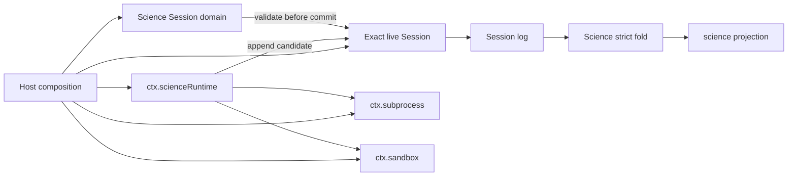

# Science Mode execution chain

English | [中文](science-mode.zh.md)

This reference connects the implemented Science Session domain and host-local Runtime to the generic DSH extension points around them. It records the current source path, responsibility boundaries, and the missing product closure without duplicating event fields or package-local operations. The [Science subsystem reference](subsystems/science.md) owns event and projection semantics, the [Science Runtime README](../packages/science/science-runtime/README.md) owns local execution behavior, and the [Science MVP Decision Record](../.agents/notes/proposed/feature/2026-08-12-science-mode-core-mvp.md) owns the complete product design and delivery stages.

## Current source path

Science is split across Host services rather than embedded in the agent loop. A Host composition loads Session persistence and projection, the Science domain and invariant, a host-local subprocess provider, a full-enforcement sandbox provider, and the Runtime. The Runtime then uses the exact live Session supplied by its caller; it never finds a Session by ID or owns another event store.

A valid Science Session first carries `agentPreset: 'science'` in its header and one admitted `science/mode-bound` event before host activity. A caller may then bind one configured environment through `ctx.scienceRuntime.bindEnvironment()`. The Runtime observes existing allowlisted Conda prefixes under full write confinement and appends one complete environment revision only after the observation is stable.

A run caller supplies the exact Session, language, code, and the durable request-header and pending tool-call references that authorize the operation. `ctx.scienceRuntime.startRun()` revalidates the environment, publishes `science/run-started` before spawn, executes a direct Python or R argv through the shared subprocess and sandbox services, and publishes exactly one `science/run-finished` only after the owned process tree is fully settled. Code, stdout, stderr, process IDs, and Host scratch paths remain outside Science events.

Every candidate Science event passes through the Science invariant before `Session.append()` commits it. The same strict fold validates live admission and cold replay. The generic Session projection registry persists only validated private checkpoints and serves the derived, client-safe `science` projection; it is a cache over the log, never another authority.

## Extension points and owners

| Responsibility | Extension point | Owner rule |
|---|---|---|
| Host composition | Cordis Loader rows and profile overlays | Runtime, projection, invariant, subprocess, and sandbox services stay on the Host; a per-session preset selects only agent-facing behavior. |
| Science applicability | `SessionHeader.agentPreset` and `science/mode-bound` | The Science Session invariant admits the mode once and rejects Science activity for a non-Science Session. |
| Model-visible environment context | `ctx.systemPrompt`, `agent/pre-step`, and logged request context | A Science prompt provider must render from durable Science state, and compaction or resume must preserve the context used by the same request. |
| Model-facing operations | `ctx.tools` | A Science tool Consumer calls owning services. It must not spawn directly or counterfeit Runtime-owned environment and run events. |
| Environment observation and runs | `ctx.scienceRuntime` | The Runtime is the sole owner of environment/run commit order, exact-Session leases, private scratch, and terminal classification. |
| Process and write confinement | `ctx.subprocess` and `ctx.sandbox` | Providers own process-tree settlement and policy enforcement; the Runtime requires host-local execution and full enforcement. |
| Durable Science truth | `Session.append()`, the Science invariant, and the strict fold | The Session log is authoritative. All public Science read state derives from the one fold. |
| Charts and Outcome | immutable attachment storage plus `science/chart-saved` and `science/outcome-published` | A Consumer validates durable backward evidence before appending. Runtime does not own these records, and Outcome never drives Goal. |
| Client presentation | `science` Session projection and a generic Details extension | A Science client reads projection and attachment references without maintaining mutable domain state. Standard Sessions receive no Science entry. |

The generic seams already exist for prompt assembly, tools, Session events, projection, subprocesses, sandboxes, and attachments. Adding Science product behavior means placing one Consumer or provider at the assigned extension point; it does not justify a Science branch inside `agent-loop` or a second database beside the Session log.

## Lifecycle and data ownership

- **Resume** reuses the same Session identity, durable log, projection history, and Runtime scratch key. A live operation holds an exact-Session lease, so another object with the same ID cannot overlap it.
- **Fork** receives a new Session ID and Runtime scratch key. Seeded log evidence remains locally replayable, while mutable Host files are not inherited.
- **Detach, cancellation, and disposal** stop owned process trees and wait for quiescence before releasing a lease or committing a terminal fact. An unproven tree keeps the same-ID lifecycle quarantined.
- **Environment drift** appends a new non-applied revision and blocks later authoritative runs. The Runtime never repairs or mutates a Conda prefix.
- **Projection reads** expose compact metadata and backward references. Executed code, output bytes, attachment bytes, and writable paths stay with their existing storage or process owners.

## Product closure

The source path currently ends at the non-model-facing Runtime API and the durable Science projection. No shipped profile binds Science mode, presents Science context to a model, registers Python/R Science tools, publishes chart or Outcome facts, or renders a Science Details view. Loading the packages therefore proves composition and API availability, not a user-visible Science Mode.

The [Science MVP Decision Record](../.agents/notes/proposed/feature/2026-08-12-science-mode-core-mvp.md#delivery-stages) assigns those remaining responsibilities and their order. Before Phase 3 source changes, its prompt, compaction, preset, query, and tool contracts must be frozen together so the first model request that can invoke a Science tool also receives reconstructable environment context.
