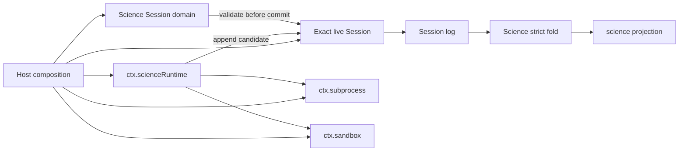

# Science Mode 执行链路

[English](science-mode.md) | 中文

本文连接已经实现的 Science Session 领域、host-local Runtime 及其周围的通用 DSH 扩展点。它记录当前源码链路、责任边界和尚未闭合的产品路径，但不重复事件字段或包内操作。[Science 子系统参考](subsystems/science.md)负责事件与 projection 语义，[Science Runtime README](../packages/science/science-runtime/README.md)负责本地执行行为，[Science MVP 决策记录](../.agents/notes/proposed/feature/2026-08-12-science-mode-core-mvp.md)负责完整产品设计与交付阶段。

## 当前源码链路

Science 由多个 Host 服务协作完成，并未嵌入 agent loop。Host 组合加载 Session 持久化与 projection、Science 领域及 invariant、host-local subprocess 提供方、full-enforcement sandbox 提供方和 Runtime。随后，Runtime 使用调用方传入的精确 live Session；它不会按 ID 查找 Session，也不拥有另一套事件存储。

一个有效的 Science Session 首先在 header 中携带 `agentPreset: 'science'`，并在任何 host activity 之前接纳唯一一条 `science/mode-bound` 事件。随后，调用方可以通过 `ctx.scienceRuntime.bindEnvironment()` 绑定一个已配置环境。Runtime 在完整写入约束下观察 allowlist 中的现有 Conda prefix，并且仅在观测结果稳定后追加一条完整环境 revision。

run 调用方传入精确 Session、语言、代码，以及授权本次操作的持久 request-header 和 pending tool-call 引用。`ctx.scienceRuntime.startRun()` 重新验证环境，在 spawn 前发布 `science/run-started`，通过共享 subprocess 与 sandbox 服务以直接 argv 执行 Python 或 R，并且仅在所属进程树完全停稳后发布唯一一条 `science/run-finished`。代码、stdout、stderr、进程 ID 和 Host scratch 路径都不会进入 Science 事件。

每条候选 Science 事件都先通过 Science invariant，再由 `Session.append()` 提交。同一个严格 fold 同时负责 live admission 与 cold replay。通用 Session projection 注册表只持久化经过验证的私有 checkpoint，并提供派生且可安全交给客户端的 `science` projection；它只是日志之上的缓存，不是另一份权威数据。

## 扩展点与责任归属

| 责任 | 扩展点 | 归属规则 |
|---|---|---|
| Host 组合 | Cordis Loader 条目与 profile overlay | Runtime、projection、invariant、subprocess 与 sandbox 服务留在 Host；逐 Session preset 只选择面向 agent 的行为。 |
| Science 适用性 | `SessionHeader.agentPreset` 与 `science/mode-bound` | Science Session invariant 只接纳一次 mode，并拒绝非 Science Session 中的 Science activity。 |
| 模型可见环境上下文 | `ctx.systemPrompt`、`agent/pre-step` 与已记录的 request context | Science prompt 提供方必须从持久 Science 状态渲染；compaction 或 resume 必须保留同一请求实际使用的上下文。 |
| 面向模型的操作 | `ctx.tools` | Science tool Consumer 调用事实所属服务。它不得直接 spawn，也不得伪造 Runtime 所属的 environment 和 run 事件。 |
| 环境观测与 run | `ctx.scienceRuntime` | Runtime 独占 environment/run 提交顺序、精确 Session lease、私有 scratch 与 terminal classification。 |
| 进程与写入约束 | `ctx.subprocess` 与 `ctx.sandbox` | 提供方负责进程树结算和 policy enforcement；Runtime 要求 host-local execution 与 full enforcement。 |
| 持久 Science 事实 | `Session.append()`、Science invariant 与严格 fold | Session log 是权威数据。所有公开 Science 读取状态都从唯一 fold 派生。 |
| 图表与 Outcome | 不可变 attachment 存储以及 `science/chart-saved`、`science/outcome-published` | Consumer 在追加前验证持久的向后 evidence。Runtime 不拥有这些 record，Outcome 也绝不驱动 Goal。 |
| 客户端呈现 | `science` Session projection 与通用 Details 扩展 | Science client 读取 projection 和 attachment 引用，不维护可变领域状态。Standard Session 不显示 Science 入口。 |

提示词组装、工具、Session 事件、projection、subprocess、sandbox 与 attachment 所需的通用 seam 已经存在。增加 Science 产品行为，就是在指定扩展点放置一个 Consumer 或提供方；它不构成在 `agent-loop` 内新增 Science 分支或在 Session log 旁建立第二套数据库的理由。

## 生命周期与数据归属

- **Resume** 复用同一个 Session identity、持久日志、projection 历史和 Runtime scratch key。live operation 持有精确 Session lease，因此另一个具有相同 ID 的对象不能与其重叠。
- **Fork** 获得新的 Session ID 和 Runtime scratch key。继承的日志 evidence 仍可在当前 Session 内回放，但可变 Host 文件不会被继承。
- **Detach、cancellation 与 disposal** 会停止所属进程树，并在释放 lease 或提交 terminal fact 前等待其完全停稳。无法证明进程树停稳时，同 ID lifecycle 继续处于隔离状态。
- **Environment drift** 会追加新的非 applied revision，并阻止后续 authoritative run。Runtime 绝不修复或修改 Conda prefix。
- **Projection read** 只公开紧凑 metadata 和向后引用。执行代码、输出字节、attachment 字节和可写路径仍由既有存储或进程 owner 持有。

## 产品链路闭合

当前源码链路止于不面向模型的 Runtime API 和持久 Science projection。随附 profile 尚未绑定 Science mode、向模型提供 Science context、注册 Python/R Science 工具、发布 chart 或 Outcome fact，也未渲染 Science Details view。因此，加载这些包只能证明组合与 API 可用，不能证明用户已经能看到 Science Mode。

[Science MVP 决策记录](../.agents/notes/proposed/feature/2026-08-12-science-mode-core-mvp.md#delivery-stages)分配了其余责任及其实现顺序。Phase 3 修改源码前，必须一起冻结 prompt、compaction、preset、query 与 tool 约定，确保首次可以调用 Science 工具的模型请求同时获得可重建的环境上下文。
